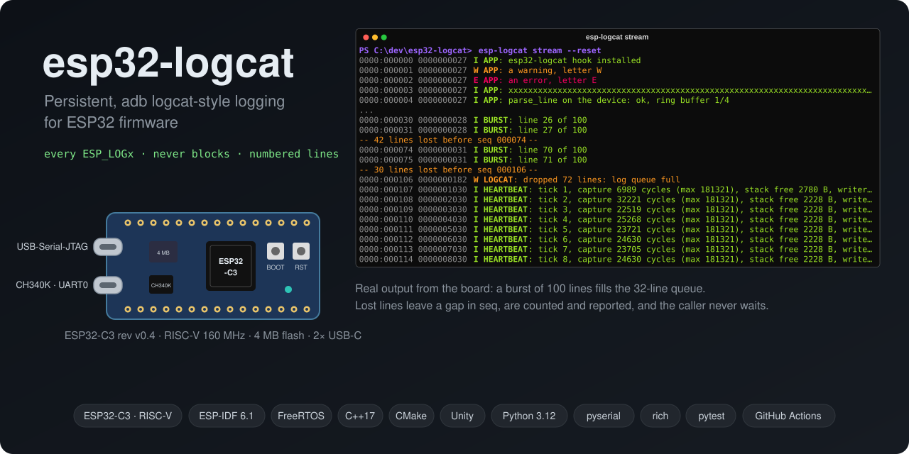

# esp32-logcat



Persistent, `adb logcat`-style logging for embedded firmware.

> **Status:** working toward v1.0. On the ESP32-C3 every `ESP_LOGx` goes through the core and
> a non-blocking queue to the native USB port; `esp-logcat stream` and the TUI show it live, and
> `esp-logcat shell` drives the board's console (milestones M2, M3, M5). The log is kept in flash
> with a boot counter (M4, most of it done); still to come: the flush policy, `esp-logcat dump`,
> and crash recovery with the timing measurement (M6).

## User manual

How to flash the board, connect, read the output and use pipes and files, with real terminal
output from the board:

- **English:** [docs/project/MANUAL.en.md](docs/project/MANUAL.en.md)
- **Português (pt-BR):** [docs/project/MANUAL.md](docs/project/MANUAL.md)

Quick start, with the firmware flashed and the board's native USB-C port plugged in:

```powershell
# PowerShell
cd C:\dev\esp32-logcat
host\.venv\Scripts\Activate.ps1
esp-logcat ports
esp-logcat stream --reset
```

```bat
:: Command Prompt (cmd)
cd /d C:\dev\esp32-logcat
host\.venv\Scripts\activate.bat
esp-logcat ports
esp-logcat stream --reset
```

`Ctrl+C` stops the stream and prints a summary. `esp-logcat tui` is the interactive view
(scroll, pause, live filter). First time on a machine (creating
`host\.venv`, flashing): see section 1 of the manual.

## What it is

Devices in the field crash, reboot or misbehave, and by the time they reach the bench there is no
record of what happened. `printf` over serial only helps while the cable is plugged in, vanishes on
reset and never tells you *why* the board restarted.

esp32-logcat is a reusable logging component plus a PC tool that:

- captures every `ESP_LOGx` call (application and ESP-IDF itself) without a new API;
- never blocks the caller — logging only enqueues, a low-priority task formats and writes;
- persists logs to a dedicated LittleFS partition with file rotation and a size cap;
- records boot count, reset reason and firmware version on every boot;
- keeps a "last words" buffer in RTC memory to recover what happened right before a panic or
  watchdog reset;
- ships `esp-logcat`, a Python CLI to stream, filter (`"*:W" "PRESSURE:D"`), dump and replay logs.

Log line format:

```
<boot>:<seq> <uptime_ms> <L> <TAG>: <message>
0042:000137 0000123456 W PRESSURE: reading out of range (4.71 V)
```

## Target

- ESP32-C3 (RISC-V), plain ESP-IDF 6.1.1 (`idf.py`), C++17.
- Platform-independent core (`firmware/components/esp32_logcat/core`) unit-tested on the host (CMake + Unity + ctest).
- Host tool: Python 3.12.

## Repository layout

```
firmware/   ESP-IDF component (core + adapters), demo app (examples/demo), core tests (test/host)
host/       esp-logcat Python CLI
docs/       project/: manuals, conventions, roadmap; context/: PRD, architecture, hardware,
            ADRs (Portuguese, except the English manual). Index in docs/README.md
```

## Building and testing

Requirements: [ESP-IDF 6.1.1](https://docs.espressif.com/projects/esp-idf/) (on Windows, through
the EIM installer), Python 3.12, and for the core tests CMake 3.25+, Ninja and a host GCC with
C++17 support.

> **Windows:** install the host GCC in a path without spaces (e.g. MSYS2 UCRT64 at `C:\msys64`).
> MinGW's linker splits paths on spaces and fails if GCC lives under `C:\Users\First Last\...`.
> Run the commands below in the ESP-IDF PowerShell (EIM's desktop shortcut): it brings the
> CMake and Ninja that the core tests use too.

Firmware (from `firmware/examples/demo`):

```sh
idf.py build             # build for the target
idf.py -p COMx flash     # flash it (the native USB port or the UART bridge)
```

Core tests on the PC (from `firmware/test/host`):

```sh
cmake --preset native && cmake --build --preset native && ctest --preset native
```

**VS Code IntelliSense:** `.vscode/settings.json` reads the compile database that `idf.py build`
writes (`firmware/examples/demo/build/compile_commands.json`); build once, and again after adding
source files, then run *C/C++: Reset IntelliSense Database* if old errors stay.

The CI also runs the core tests under sanitizers: the `asan` (AddressSanitizer +
UndefinedBehaviorSanitizer) and `tsan` (ThreadSanitizer) presets. They need a Linux toolchain
(MinGW on Windows has no ASan/TSan runtime), so run them on Linux or WSL:

```sh
cmake --preset asan && cmake --build --preset asan && ctest --preset asan
cmake --preset tsan && cmake --build --preset tsan && ctest --preset tsan
```

Host tool:

```sh
cd host
python -m venv .venv
.venv/Scripts/activate        # Linux/macOS: source .venv/bin/activate
pip install -e ".[dev]"
pytest
ruff check . && ruff format --check .
```

## Related

- [esp32-devkit-tester](https://github.com/RenatoFaraco/esp32-devkit-tester) — test any ESP32
  dev board in seconds: a terminal UI that checks UART, JTAG, eFuses, flash and PSRAM and reports
  Jest-style.

## License

[MIT](LICENSE)
