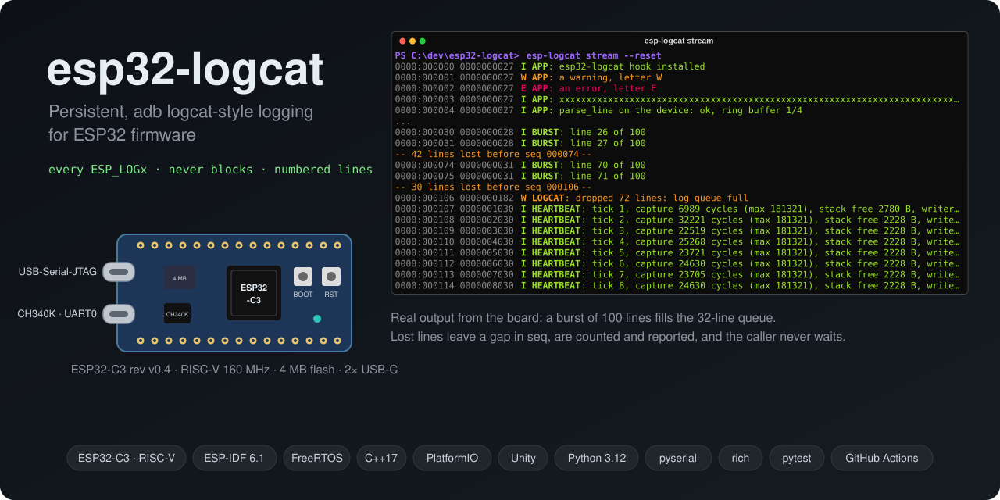

# esp32-logcat



Persistent, `adb logcat`-style logging for embedded firmware.

> **Status:** early development. On the ESP32-C3 every `ESP_LOGx` already goes through the
> core and a non-blocking queue to the native USB port, and `esp-logcat stream` shows it live
> (milestones M2/M3). Persistence in flash, the console and crash recovery are next.

## User manual

How to flash the board, connect, read the output and use pipes and files, with real terminal
output from the board:

- **English:** [docs/MANUAL.en.md](docs/MANUAL.en.md)
- **Português (pt-BR):** [docs/MANUAL.md](docs/MANUAL.md)

Quick start, with the firmware flashed and the board's native USB-C port plugged in:

```powershell
# PowerShell
cd C:\dev\esp32-logcat
host\.venv\Scripts\Activate.ps1
esp-logcat ports
esp-logcat stream --reset
```

```bat
:: Command Prompt (cmd)
cd /d C:\dev\esp32-logcat
host\.venv\Scripts\activate.bat
esp-logcat ports
esp-logcat stream --reset
```

`Ctrl+C` stops the stream and prints a summary. `esp-logcat tui` is the interactive view
(scroll, pause, live filter). First time on a machine (creating
`host\.venv`, flashing): see section 1 of the manual.

## What it is

Devices in the field crash, reboot or misbehave, and by the time they reach the bench there is no
record of what happened. `printf` over serial only helps while the cable is plugged in, vanishes on
reset and never tells you *why* the board restarted.

esp32-logcat is a reusable logging component plus a PC tool that:

- captures every `ESP_LOGx` call (application and ESP-IDF itself) without a new API;
- never blocks the caller — logging only enqueues, a low-priority task formats and writes;
- persists logs to a dedicated LittleFS partition with file rotation and a size cap;
- records boot count, reset reason and firmware version on every boot;
- keeps a "last words" buffer in RTC memory to recover what happened right before a panic or
  watchdog reset;
- ships `esp-logcat`, a Python CLI to stream, filter (`"*:W" "PRESSURE:D"`), dump and replay logs.

Log line format:

```
<boot>:<seq> <uptime_ms> <L> <TAG>: <message>
0042:000137 0000123456 W PRESSURE: reading out of range (4.71 V)
```

## Target

- ESP32-C3 (RISC-V), ESP-IDF via PlatformIO, C++17.
- Platform-independent core (`firmware/lib/logcat_core`) unit-tested on the host (`env:native`).
- Host tool: Python 3.12.

## Repository layout

```
firmware/   PlatformIO project (core library, ESP-IDF adapters, demo app, tests)
host/       esp-logcat Python CLI
docs/       PRD, architecture, roadmap, conventions and ADRs (Portuguese)
```

## Building and testing

Requirements: [PlatformIO Core](https://platformio.org/install/cli) 6.1+, Python 3.12, and a host
C++ compiler for `env:native` (GCC with C++17 support).

> **Windows:** install the host GCC in a path without spaces (e.g. MSYS2 UCRT64 at `C:\msys64`).
> MinGW's linker splits paths on spaces and fails if GCC lives under `C:\Users\First Last\...`.

Firmware:

```sh
cd firmware
pio test -e native     # core unit tests on the PC
pio run -e esp32c3     # build for the target
```

**VS Code IntelliSense** (errors like `cannot open source file "freertos/FreeRTOS.h"`): the
repository root is opened as the workspace, not the PlatformIO project in `firmware/`, so the
PlatformIO extension does not configure IntelliSense. `.vscode/settings.json` points it at a
compile database instead; generate it once, and again after adding source files:

```sh
pio run -d firmware -e esp32c3 -t compiledb   # writes firmware/compile_commands.json (ignored)
```

The database names the compiler without a path, so `.vscode/settings.json` also sets
`C_Cpp.default.compilerPath` from the `PLATFORMIO_CORE_DIR` environment variable
(`<core>/packages/toolchain-riscv32-esp/bin/riscv32-esp-elf-g++.exe`): without it, IntelliSense
cannot query the RISC-V compiler and reports errors such as `identifier "_REENT" is undefined`.
If PlatformIO lives in its default place (`%USERPROFILE%\.platformio`), set that variable or
adjust the path in your user settings.

Then run *C/C++: Reset IntelliSense Database* from the command palette if the errors stay.

The CI also runs the core tests under sanitizers: `native_asan` (AddressSanitizer +
UndefinedBehaviorSanitizer) and `native_tsan` (ThreadSanitizer). They need a Linux toolchain —
MinGW on Windows has no ASan/TSan runtime — so run them on Linux or WSL:

```sh
pio test -e native_asan -v   # -v shows the sanitizer report if a test fails
pio test -e native_tsan -v
```

Host tool:

```sh
cd host
python -m venv .venv
.venv/Scripts/activate        # Linux/macOS: source .venv/bin/activate
pip install -e ".[dev]"
pytest
ruff check . && ruff format --check .
```

## License

[MIT](LICENSE)
