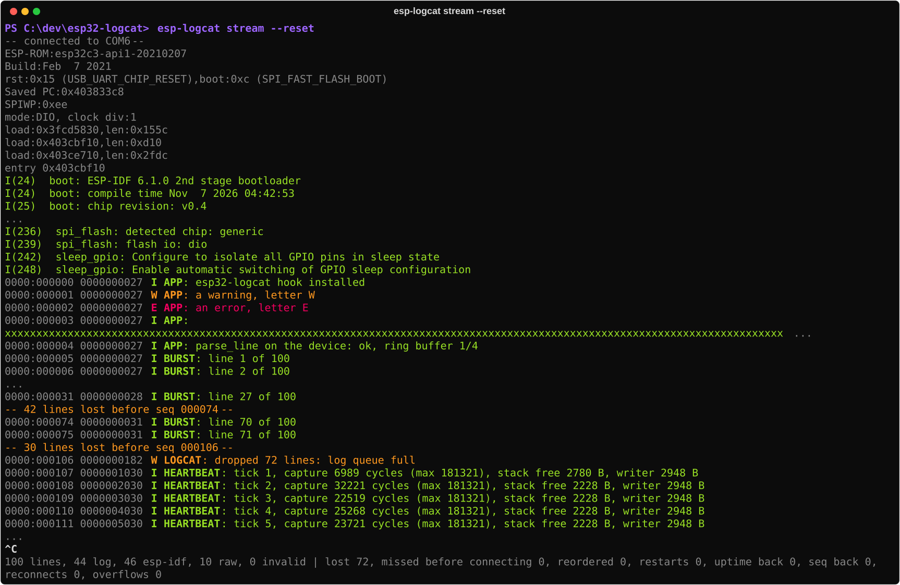
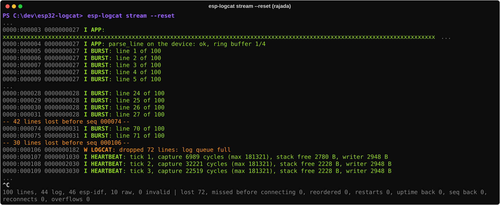
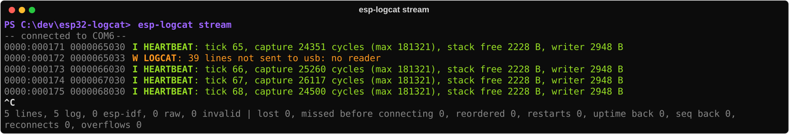
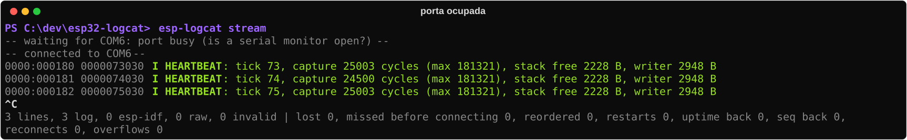
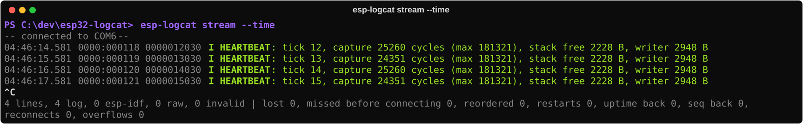
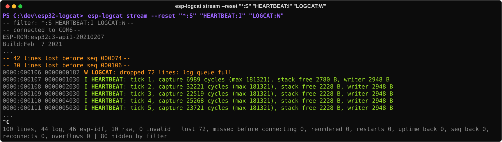

# Manual de uso — esp32-logcat

> Para quem vai **usar** o sistema: gravar o firmware, ligar a placa e acompanhar os logs no
> PC com `esp-logcat`. Como o sistema funciona por dentro: `ARCHITECTURE.md`. Fatos da placa e
> armadilhas de USB: `hardware.md`.

As imagens do terminal deste manual são **saídas reais da placa**: sessões gravadas com
`scripts/record_session.py` e desenhadas pelo mesmo código do `esp-logcat stream`
(`scripts/manual_screenshots.py`, ver [o fim do manual](#como-as-imagens-foram-feitas)).

> English version: [MANUAL.en.md](MANUAL.en.md)

## Comece aqui

Com o firmware gravado e a placa ligada pela USB-C da porta nativa, abra um terminal
(**PowerShell** ou **Prompt de Comando**, o `cmd`; no VS Code: menu *Terminal → New Terminal*)
e digite:

**PowerShell**

```powershell
cd C:\dev\esp32-logcat
host\.venv\Scripts\Activate.ps1
esp-logcat ports
esp-logcat stream --reset
```

**Prompt de Comando (cmd)**

```bat
cd /d C:\dev\esp32-logcat
host\.venv\Scripts\activate.bat
esp-logcat ports
esp-logcat stream --reset
```

`Ctrl+C` encerra. Os comandos do `esp-logcat` são os mesmos nos dois terminais; o que muda
é só a ativação do ambiente (2ª linha) e alguns truques de pipe (seção 4). Primeira vez na
máquina, sem o ambiente criado ou sem firmware gravado: seção 1.

## Sumário

1. [Do zero ao logcat funcionando](#1-do-zero-ao-logcat-funcionando)
2. [Lendo a saída](#2-lendo-a-saída)
3. [O que acontece em cada situação](#3-o-que-acontece-em-cada-situação)
4. [Pipe, grep e arquivo](#4-pipe-grep-e-arquivo)
5. [As duas portas da placa](#5-as-duas-portas-da-placa)
6. [Solução de problemas](#6-solução-de-problemas)
7. [Referência rápida](#7-referência-rápida)

---

## 1. Do zero ao logcat funcionando

### 1.1 O que você precisa

- Placa ESP32-C3 com as duas USB-C (a usada aqui: `hardware.md`).
- Windows com PlatformIO (`C:\.platformio`) e Python 3.12. Os comandos funcionam no
  **PowerShell** e no **Prompt de Comando (cmd)**, a partir da raiz do repositório
  (`C:\dev\esp32-logcat`); onde os dois diferem, o manual mostra as duas formas.
- **Um cabo na USB-C da porta nativa (USB-Serial-JTAG)**, ligado **direto numa porta do PC**,
  sem hub: atrás de hub, um reset pelo pino EN às vezes faz o Windows perder a porta
  (`hardware.md`, item 5). A outra USB-C (ponte CH340K) é opcional: é o console completo.

### 1.2 Instalar a ferramenta do PC (uma vez)

```powershell
cd host
py -3.12 -m venv .venv
.venv\Scripts\python -m pip install -e ".[dev]"
cd ..
```

(No cmd, os mesmos comandos funcionam; troque `cd ..` por `cd /d C:\dev\esp32-logcat`.)

Isso cria o comando `host\.venv\Scripts\esp-logcat.exe`. Para não digitar o caminho, **ative o
ambiente** em cada terminal que abrir e use só `esp-logcat`, como no resto deste manual:

| Terminal | Ativar | Sinal de que deu certo |
|----------|--------|------------------------|
| PowerShell | `host\.venv\Scripts\Activate.ps1` | o prompt passa a começar com `(.venv)` |
| cmd | `host\.venv\Scripts\activate.bat` | idem |

Sem ativar, use o caminho completo: `host\.venv\Scripts\esp-logcat.exe stream`.

Se o PowerShell disser que "a execução de scripts foi desabilitada neste sistema", libere os
scripts locais para o seu usuário (uma vez) com
`Set-ExecutionPolicy -Scope CurrentUser RemoteSigned`, ou use o cmd, ou o caminho completo.

### 1.3 Gravar o firmware

Com a placa ligada pela porta nativa:

```powershell
C:\.platformio\penv\Scripts\pio.exe run -d firmware -e esp32c3 -t upload --upload-port COM6
```

Troque `COM6` pela porta nativa da sua máquina (próximo passo). O primeiro build leva alguns
minutos; os seguintes, segundos.

### 1.4 Descobrir as portas

```powershell
esp-logcat ports
```


A porta marcada **`native USB-Serial-JTAG`** é a do logcat. O número da COM muda de PC para
PC (e às vezes de porta USB para porta USB): a ferramenta nunca fixa um número.

### 1.5 Ver os logs

```powershell
esp-logcat stream --reset
```

Sem `--port`, a ferramenta escolhe sozinha a porta nativa, se houver só uma. `--reset`
reinicia a placa ao conectar, para você ver o boot desde o começo:



O que aparece, de cima para baixo:

1. `-- connected to COM6 --` — aviso da ferramenta (vai para o stderr, seção 2.3).
2. **Mensagens da ROM** (`ESP-ROM:`, `rst:0x15 ...`) — texto cru, apagado.
3. **Boot do ESP-IDF** (`I (24) boot: ...`) — o formato nativo do IDF, na cor do nível: são os
   logs de antes de o firmware instalar o hook do logcat.
4. **As linhas do logcat** (`0000:000000 0000000027 I APP: ...`) — daqui em diante, todo
   `ESP_LOGx` da aplicação e do próprio IDF passa pelo núcleo do esp32-logcat.
5. A **rajada** do app de demo (`BURST`) e o **heartbeat** a cada segundo.
6. `Ctrl+C` encerra e imprime um **resumo** da sessão.

Pronto: isso é o logcat funcionando.

---

## 2. Lendo a saída

### 2.1 Anatomia de uma linha

```
0000:000107 0000001030 I HEARTBEAT: tick 1, capture 6989 cycles (max 181321), stack free 2780 B
│    │      │          │ │          └─ mensagem (até 127 caracteres; cortada termina em "...")
│    │      │          │ └─ tag (quem logou; até 15 caracteres)
│    │      │          └─ nível: E erro · W aviso · I info · D debug · V verbose
│    │      └─ uptime: milissegundos desde o boot (10 dígitos)
│    └─ seq: número da linha neste boot (6 dígitos, volta a 0 depois de 999999)
└─ boot: contador de boots (sempre 0000 até o marco M4)
```

O `seq` é a peça mais importante: **toda linha que o firmware aceitou ganha um número**, na
ordem. Se faltar um número, uma linha se perdeu, e a ferramenta avisa (seção 3.2). Linhas
silenciadas pelo filtro de tag **não** ganham número: não viram falsas perdas.

Cada linha tem no máximo 170 bytes e só caracteres ASCII imprimíveis (formato completo:
`PRD.md` §3).

### 2.2 Cores

| Nível | Cor | Exemplo |
|-------|-----|---------|
| `E` erro | vermelho | `E APP: an error, letter E` |
| `W` aviso | amarelo | `W APP: a warning, letter W` |
| `I` info | verde | `I HEARTBEAT: tick 1 ...` |
| `D` debug | azul claro | — |
| `V` verbose | cor normal do terminal | — |

- Nas linhas do logcat, o cabeçalho (`boot:seq uptime`) fica apagado; nível e tag em negrito.
- Linhas do ESP-IDF (`I (24) boot: ...`) usam a cor do nível, sem negrito.
- Texto cru (ROM, `printf`) fica apagado.
- Linhas inválidas aparecem com um rótulo vermelho: `!! torn: ...` (seção 3.6).
- Caracteres de controle vindos da placa aparecem escapados (`\x1b`, `\u202E`): a placa
  nunca consegue mexer no seu terminal.

Fora de um terminal (em pipe ou arquivo) as cores somem sozinhas.

### 2.3 Avisos e resumo (stderr)

Tudo que **não** é linha da placa vai para o **stderr**, entre `-- --`:

| Aviso | Significado |
|-------|-------------|
| `connected to COM6` | porta aberta (com `(was COM5)` se a placa voltou em outro número) |
| `waiting for COM6: not available` | porta não existe (placa desligada, cabo fora): tentando de novo a cada 0,5 s |
| `waiting for COM6: port busy` | outro programa está com a porta aberta |
| `COM6: connection lost (...)` | a porta caiu no meio da leitura; a ferramenta espera e reconecta |
| `N lines lost before seq X` | faltaram N números de `seq`: linhas perdidas |
| `N lines written before the connection not received` | linhas escritas antes de você conectar (não é perda da placa) |
| `seq X arrived after Y` | linha fora de ordem (normal em rajadas com várias tarefas) |
| `device restarted (...)` | a placa reiniciou (o `seq` e o uptime voltaram a zero) |
| `uptime went back ...` / `seq went back ...` | linha provavelmente corrompida |

Ao sair (`Ctrl+C`), o resumo conta as linhas de cada tipo e os eventos da sessão:

```
100 lines, 44 log, 46 esp-idf, 10 raw, 0 invalid | lost 72, missed before connecting 0, reordered 0,
restarts 0, uptime back 0, seq back 0, reconnects 0, overflows 0
```

### 2.4 Linhas que o próprio firmware escreve (`LOGCAT`)

O firmware explica as próprias perdas com linhas `W LOGCAT:`, que têm `seq` como qualquer
outra:

| Linha | Quando |
|-------|--------|
| `W LOGCAT: dropped N lines: log queue full` | o código logou mais rápido do que a tarefa escritora conseguia escrever: a fila (32 linhas) encheu e N linhas foram descartadas **sem travar quem logou** |
| `W LOGCAT: N lines not sent to usb: no reader` | a porta nativa ficou fechada (ninguém lendo) e N linhas não foram enviadas por ela |

---

## 3. O que acontece em cada situação

### 3.1 Boot com `--reset`

Visto na seção 1.5. Sem `--reset`, a ferramenta só começa a mostrar a partir de quando você
conecta (a placa continua rodando).

### 3.2 Rajada: a fila encheu

O app de demo loga 100 linhas seguidas no boot, mais rápido do que a tarefa escritora consegue
escrever (o espelho na UART leva ~15 ms por linha). A fila de 32 linhas enche e o resto é
**descartado e contado** — o código que loga nunca espera:



- `-- 42 lines lost before seq 000074 --` e `-- 30 lines lost ... --`: a ferramenta viu os
  buracos no `seq` (27 → 74 e 75 → 106).
- `W LOGCAT: dropped 72 lines: log queue full`: o firmware confirma: 42 + 30 = 72.

É o comportamento desejado: **perder linhas visivelmente é melhor do que atrasar a aplicação**
(ADR-004).

### 3.3 Porta fechada por um tempo e reaberta

A placa continua logando com ninguém lendo a porta nativa; ela **não trava** por isso (cada log
continua levando microssegundos). Ao reabrir:



`W LOGCAT: 39 lines not sent to usb: no reader` diz quantas linhas a porta nativa não pôde
enviar enquanto estava fechada. Não há aviso de perda na ferramenta: a primeira linha já é a
atual, e o `seq` segue contínuo a partir dela.

### 3.4 Porta ocupada

Se outro programa (um `pio device monitor`, o monitor do VS Code, outra instância do
esp-logcat) estiver com a porta aberta, a ferramenta espera, e conecta assim que a porta
ficar livre:



### 3.5 Cabo desconectado, placa reiniciada, COM que mudou

A ferramenta **nunca desiste**: se a porta cai, ela avisa, espera e reconecta.

```
-- COM6: connection lost (ClearCommError failed ...) --
-- waiting for COM6: not available --
-- connected to COM7 (was COM6) --
```

Se a placa voltar com **outro número de COM**, ela é reencontrada pelo número de série (na
porta nativa, o número de série é o MAC da placa) ou, na ponte CH340K, pela posição física no
USB. Se a placa reiniciar, aparece `-- device restarted (...) --`.

### 3.6 Linha rasgada (`!! torn`)

Uma linha sem o `\n` final — típico de uma linha cortada no meio por um reset ou por fechar a
porta — aparece como `!! torn: <bytes>`. Ela é mostrada, nunca confundida com uma linha
válida, e contada no resumo (`invalid (torn N)`).

### 3.7 Hora do PC ao lado (`--time`)

```powershell
esp-logcat stream --time
```



A primeira coluna é a hora do PC em que a linha chegou (`HH:MM:SS.mmm`), útil para cruzar com
outros registros. O uptime da placa continua na linha.

### 3.8 Filtros: só o que interessa

Os filtros seguem a sintaxe do `adb logcat`: cada argumento é `TAG:NÍVEL`, e uma linha aparece
se o nível dela for **igual ou mais grave** que o da sua tag.

```powershell
esp-logcat stream "*:W"                         # só avisos e erros, de todas as tags
esp-logcat stream "*:S" "PRESSURE:D"            # só a tag PRESSURE, até debug
esp-logcat stream "*:W" "HEARTBEAT:I"           # avisos e erros, mais o heartbeat
esp-logcat stream --reset "*:S" "HEARTBEAT:I" "LOGCAT:W"
```



| Parte | Significado |
|-------|-------------|
| `TAG:L` | a tag `TAG` no nível `L` ou mais grave. Níveis, do mais grave ao menos: `E` `W` `I` `D` `V` |
| `TAG:S` ou `TAG:N` | silencia a tag (`S` é o "silent" do adb, `N` o `None` do firmware) |
| `TAG` | o mesmo que `TAG:V` (tudo da tag) |
| `*:L` | o nível de **todas as outras tags**. Sem `*:`, as outras continuam aparecendo |

- A regra da tag vence a do `*`, em qualquer ordem. A mesma tag duas vezes: vale a última.
- A tag diferencia maiúsculas de minúsculas (`HEARTBEAT` ≠ `heartbeat`); o nível, não.
- Linhas sem tag (texto da ROM, `!! torn`) **sempre aparecem**.
- **O filtro só esconde:** as lacunas de `seq` e o resumo continuam contando todas as linhas,
  e o resumo diz quantas foram escondidas (`N hidden by filter`). Esconder uma tag nunca vira
  "linhas perdidas". O stderr começa com `-- filter: ... --` para lembrar o que está ativo.
- Os avisos de `seq` (`lines lost`, `arrived after`) valem para **todas** as linhas, inclusive as
  escondidas: podem citar um `seq` que você não está vendo. Ao silenciar tudo com `*:S`, mantenha
  `"LOGCAT:W"`, senão você não vê as linhas em que a própria placa explica as perdas.
- Vários filtros podem vir num argumento só (`"*:S HEARTBEAT:I"`), mas não intercalados com
  opções: `stream "*:S" --time "APP:D"` dá erro. Ponha as opções antes ou depois.
- Filtro inválido (`APP:F`, `APP:X`) encerra com uma mensagem de erro explicando o que vale.

**Aspas:** no PowerShell e no cmd, `"*:W"` funciona com ou sem aspas. No bash (Git Bash, Linux),
use aspas, senão o `*` vira nome de arquivo.

---

## 4. Pipe, grep e arquivo

O stdout recebe **só as linhas da placa, exatamente como ela as escreveu** — sem cores, sem
avisos. Os avisos e o resumo vão para o stderr. Isso permite:

**PowerShell**

```powershell
# filtrar ao vivo
esp-logcat stream | Select-String "HEARTBEAT"
esp-logcat stream | Select-String -CaseSensitive " W ", " E "    # só avisos e erros

# só as primeiras 20 linhas (a ferramenta encerra sozinha)
esp-logcat stream | Select-Object -First 20

# salvar a sessão com os bytes exatos da placa (e os avisos em outro arquivo)
cmd /c "esp-logcat stream > sessao.log 2> avisos.log"
```

> **Cuidado no Windows PowerShell 5.1:** `esp-logcat stream > sessao.log` grava o arquivo em
> **UTF-16**, não com os bytes da placa. Use o `cmd /c` acima (ou o PowerShell 7, cujo `>`
> grava UTF-8). Num pipe, o PowerShell mostra "exit code 255" quando encerra o processo no fim
> do pipeline (`Select-Object -First`): é o PowerShell parando o `stream`, não um erro dele.

**Prompt de Comando (cmd)**

```bat
:: salvar a sessão (bytes exatos da placa) e os avisos em outro arquivo
esp-logcat stream > sessao.log 2> avisos.log

:: depois, filtrar o arquivo salvo
findstr HEARTBEAT sessao.log
findstr /C:" W " /C:" E " sessao.log
```

> No cmd, o `findstr` **não serve para filtrar ao vivo**: num pipe (`stream | findstr ...`) ele
> guarda a saída em buffer e não mostra nada até o fim (testado). Para filtrar ao vivo, use o
> PowerShell (`Select-String`) ou os filtros da própria ferramenta (seção 3.8), que funcionam
> igual nos dois terminais. O `>` do cmd grava os bytes exatos.

Os filtros da ferramenta combinam com tudo isto: `esp-logcat stream "*:W" > avisos-e-erros.log`.

---

## 5. As duas portas da placa

| | **Nativa (COM6)** — o logcat | **Ponte UART (COM5)** — o console |
|---|---|---|
| ROM, bootloader, início do boot (formato do IDF) | sim | sim |
| Linhas do logcat | sim, com `\n` | sim (espelho), com `\r\n` |
| `printf` e texto que não é log | não | sim |
| Avisos `W LOGCAT` | sim | sim |
| Abrir a porta reseta a placa? | não | não, se aberta com DTR/RTS soltos (o esp-logcat e o `pio device monitor` deste projeto fazem isso) |

Use a **nativa** para o logcat. Use a **COM5** quando precisar do console completo
(`esp-logcat stream --port COM5` também funciona) ou quando estiver gravando pela nativa.

---

## 6. Solução de problemas

| Sintoma | Causa provável | O que fazer |
|---------|----------------|-------------|
| `cannot choose a port (found: ...); use --port` | nenhuma porta nativa, ou mais de uma | rode `esp-logcat ports` e passe `--port COMx` |
| `waiting for COM6: port busy` | outro programa com a porta aberta | feche o monitor serial (VS Code, PlatformIO, outro terminal) |
| `waiting for COM6: not available` sem fim | placa desligada, cabo só de energia, ou a porta mudou de número e a placa ainda não tinha sido vista nesta sessão | confira o cabo; rode `esp-logcat ports` |
| `esp-logcat` não é reconhecido como comando | o ambiente não está ativado neste terminal | ative (seção 1.2) ou use `host\.venv\Scripts\esp-logcat.exe` |
| A porta nativa sumiu depois de um reset pela CH340K; o Windows mostra "Dispositivo USB Desconhecido" | placa atrás de um hub (`hardware.md`, item 5) | desconecte e reconecte o cabo; ligue a nativa direto no PC |
| Muitos `lines lost` com tráfego alto | a aplicação loga mais de ~70 linhas/s (limite do espelho na UART) | esperado: as perdas são contadas, nunca travam a aplicação. O app de 1 kHz (#13) vai desligar o espelho |
| `W LOGCAT: N lines not sent to usb` | a porta nativa ficou fechada | normal: são as linhas do período em que ninguém lia |
| Nada aparece na COM6, mas a COM5 mostra os logs | firmware antigo, de antes do logcat | grave o firmware atual (seção 1.3) |
| Gravar falha com a porta aberta | o `stream` está segurando a COM | pare o `stream` (`Ctrl+C`) antes de gravar, ou grave pela outra porta |

---

## 7. Referência rápida

```
esp-logcat ports                         lista as portas e marca a nativa
esp-logcat stream [opções] [TAG:L ...]   logs ao vivo, com filtros opcionais (seção 3.8)
    "*:W"  "*:S" "TAG:D"  ...            filtros do logcat: níveis E W I D V, S/N silencia
    --port COMx                          porta (padrão: a nativa, se houver só uma)
    --baud N                             baud rate (padrão 115200; só importa na COM5)
    --reset                              reinicia a placa ao conectar
    --time                               mostra a hora do PC em cada linha
esp-logcat --version
```

Ainda não implementados: `replay` de arquivo salvo (#19), `dump` e `shell`
(marco M5), interface interativa `esp-logcat tui` (#56).

---

## Como as imagens foram feitas

1. `scripts/record_session.py <porta> <segundos> <saida.json> [--reset]` grava, de uma sessão
   real com a placa, exatamente o que o transporte serial entregou (bytes e avisos) com o tempo
   de cada um. As gravações estão em `docs/manual/sessions/`.
2. `scripts/manual_screenshots.py` passa cada gravação pelo mesmo pipeline e pelo mesmo
   renderer do `esp-logcat stream` e exporta a janela de terminal em SVG para
   `docs/manual/img/`. Cortes em sessões longas aparecem como `...`.
3. `scripts/readme_cover.py` desenha a capa do README (`docs/img/cover.svg`) com saída real
   das mesmas gravações.

Quando a saída mudar, grave de novo e rode os scripts: as imagens sempre mostram o que a
ferramenta realmente faz.
