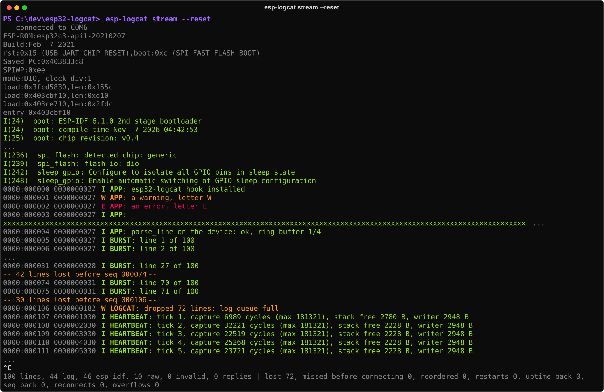
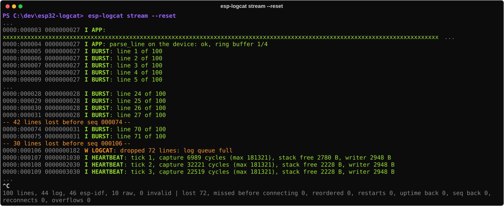
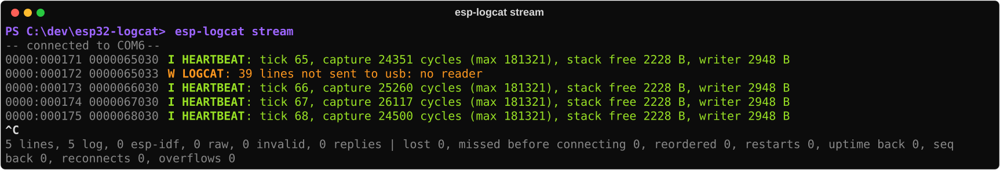
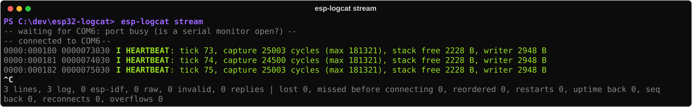
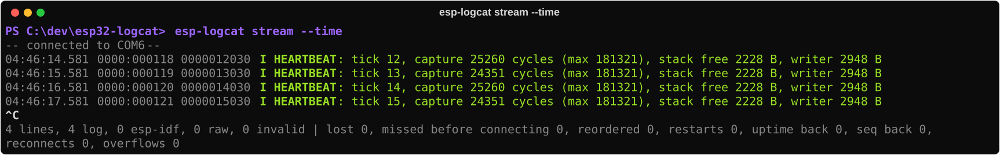
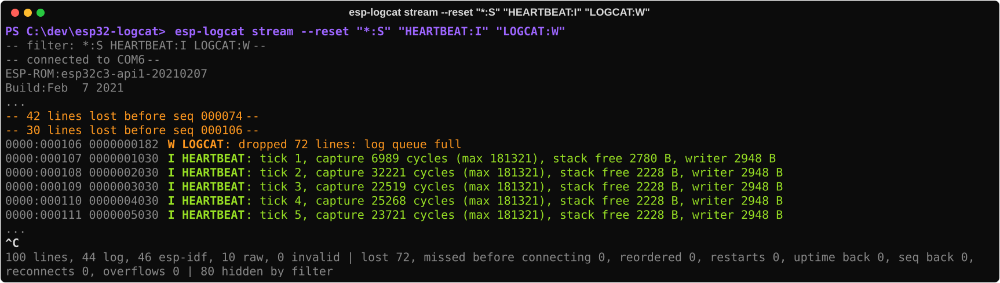
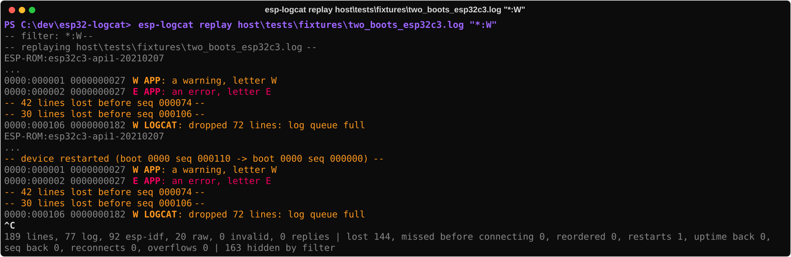
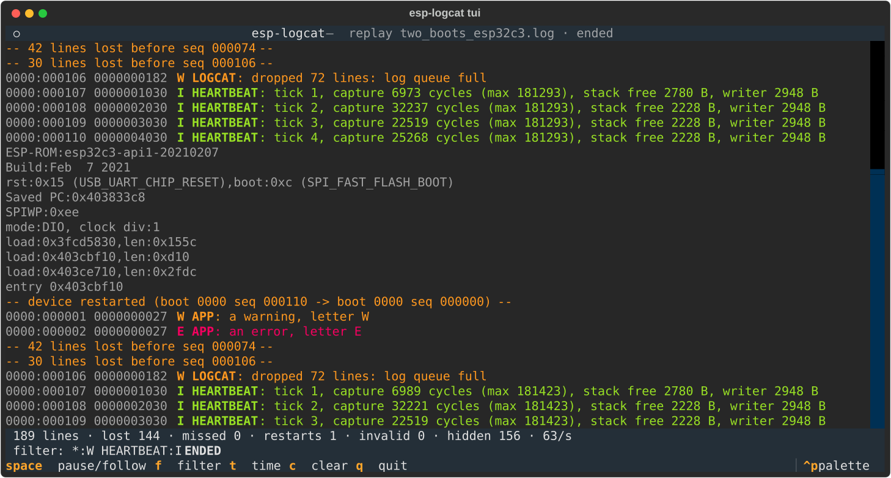

# User manual — esp32-logcat

> For people who will **use** the system: flash the firmware, plug the board in and follow its
> logs on the PC with `esp-logcat`. How it works inside: `ARCHITECTURE.md` (Portuguese). Board
> facts and USB pitfalls: `hardware.md` (Portuguese).

> Versão em português: [MANUAL.md](MANUAL.md)

The terminal pictures in this manual are **real output from the board**: sessions recorded with
`scripts/record_session.py` and drawn by the same code as `esp-logcat stream`
(`scripts/manual_screenshots.py`, see [the end of this manual](#how-the-pictures-were-made)).

## Start here

With the firmware flashed and the board plugged in through the native USB-C port, open a
terminal (**PowerShell** or **Command Prompt**, `cmd`; in VS Code: *Terminal → New Terminal*)
and type:

**PowerShell**

```powershell
cd C:\dev\esp32-logcat
host\.venv\Scripts\Activate.ps1
esp-logcat ports
esp-logcat stream --reset
```

**Command Prompt (cmd)**

```bat
cd /d C:\dev\esp32-logcat
host\.venv\Scripts\activate.bat
esp-logcat ports
esp-logcat stream --reset
```

`Ctrl+C` stops it. The `esp-logcat` commands are the same in both terminals; only the
environment activation (2nd line) and a few pipe tricks (section 4) differ. First time on this
machine, no environment yet or no firmware on the board: section 1.

## Contents

1. [From zero to a running logcat](#1-from-zero-to-a-running-logcat)
2. [Reading the output](#2-reading-the-output)
3. [What happens in each situation](#3-what-happens-in-each-situation)
4. [Pipes, grep and files](#4-pipes-grep-and-files)
5. [The board's two ports](#5-the-boards-two-ports)
6. [Troubleshooting](#6-troubleshooting)
7. [Quick reference](#7-quick-reference)

---

## 1. From zero to a running logcat

### 1.1 What you need

- An ESP32-C3 board with two USB-C ports (the one used here: `hardware.md`).
- Windows with PlatformIO (`C:\.platformio`) and Python 3.12. The commands work in
  **PowerShell** and in the **Command Prompt (cmd)**, from the repository root
  (`C:\dev\esp32-logcat`); where the two differ, this manual shows both.
- **A cable on the USB-C of the native port (USB-Serial-JTAG)**, plugged **straight into the
  PC**, not into a hub: behind a hub, a reset through the EN pin sometimes makes Windows lose
  the port (`hardware.md`, item 5). The other USB-C (CH340K bridge) is optional: it carries the
  full console.

### 1.2 Install the PC tool (once)

```powershell
cd host
py -3.12 -m venv .venv
.venv\Scripts\python -m pip install -e ".[dev]"
cd ..
```

(The same commands work in cmd; replace `cd ..` with `cd /d C:\dev\esp32-logcat`.)

This creates the command `host\.venv\Scripts\esp-logcat.exe`. To avoid typing the path,
**activate the environment** in each terminal you open and use just `esp-logcat`, as the rest
of this manual does:

| Terminal | Activate | Sign that it worked |
|----------|----------|---------------------|
| PowerShell | `host\.venv\Scripts\Activate.ps1` | the prompt starts with `(.venv)` |
| cmd | `host\.venv\Scripts\activate.bat` | same |

Without activating, use the full path: `host\.venv\Scripts\esp-logcat.exe stream`.

If PowerShell says that "running scripts is disabled on this system", allow local scripts for
your user (once) with `Set-ExecutionPolicy -Scope CurrentUser RemoteSigned`, or use cmd, or the
full path.

### 1.3 Flash the firmware

With the board plugged in through the native port:

```powershell
C:\.platformio\penv\Scripts\pio.exe run -d firmware -e esp32c3 -t upload --upload-port COM6
```

Replace `COM6` with your machine's native port (next step). The first build takes a few
minutes; later ones, seconds.

### 1.4 Find the ports

```powershell
esp-logcat ports
```


The port marked **`native USB-Serial-JTAG`** is the logcat one. The COM number changes from PC
to PC (and sometimes from USB socket to USB socket): the tool never hard-codes a number.

### 1.5 Watch the logs

```powershell
esp-logcat stream --reset
```

Without `--port`, the tool picks the native port by itself when there is exactly one.
`--reset` restarts the board when connecting, so you see the boot from the start:



What shows up, top to bottom:

1. `-- connected to COM6 --` — a notice from the tool (it goes to stderr, section 2.3).
2. **ROM messages** (`ESP-ROM:`, `rst:0x15 ...`) — raw text, dimmed.
3. **ESP-IDF boot** (`I (24) boot: ...`) — ESP-IDF's native format, in the level's color:
   these are the logs printed before the firmware installs the logcat hook.
4. **Logcat lines** (`0000:000000 0000000027 I APP: ...`) — from here on, every `ESP_LOGx` of
   the application and of ESP-IDF itself goes through the esp32-logcat core.
5. The demo app's **burst** (`BURST`) and the **heartbeat**, once a second.
6. `Ctrl+C` stops and prints a **summary** of the session.

That's it: the logcat is running.

---

## 2. Reading the output

### 2.1 Anatomy of a line

```
0000:000107 0000001030 I HEARTBEAT: tick 1, capture 6989 cycles (max 181321), stack free 2780 B
│    │      │          │ │          └─ message (up to 127 characters; a cut one ends in "...")
│    │      │          │ └─ tag (who logged; up to 15 characters)
│    │      │          └─ level: E error · W warning · I info · D debug · V verbose
│    │      └─ uptime: milliseconds since boot (10 digits)
│    └─ seq: line number in this boot (6 digits, wraps to 0 after 999999)
└─ boot: boot counter (always 0000 until milestone M4)
```

`seq` is the key piece: **every line the firmware accepted gets a number**, in order. If a
number is missing, a line was lost, and the tool says so (section 3.2). Lines silenced by the
tag filter do **not** get a number: they never look like losses.

Each line is at most 170 bytes of printable ASCII (full format: `docs/context/spec/wire-format.md` §1).

### 2.2 Colors

| Level | Color | Example |
|-------|-------|---------|
| `E` error | red | `E APP: an error, letter E` |
| `W` warning | yellow | `W APP: a warning, letter W` |
| `I` info | green | `I HEARTBEAT: tick 1 ...` |
| `D` debug | bright blue | — |
| `V` verbose | the terminal's default color | — |

- On logcat lines the header (`boot:seq uptime`) is dimmed; level and tag are bold.
- ESP-IDF lines (`I (24) boot: ...`) use the level's color, without bold.
- Raw text (ROM, `printf`) is dimmed.
- Invalid lines get a red label: `!! torn: ...` (section 3.6).
- Control characters coming from the board are shown escaped (`\x1b`, `\u202E`): the board can
  never drive your terminal.

Outside a terminal (in a pipe or a file) the colors go away by themselves.

### 2.3 Notices and summary (stderr)

Everything that is **not** a line from the board goes to **stderr**, between `-- --`:

| Notice | Meaning |
|--------|---------|
| `connected to COM6` | port open (with `(was COM5)` if the board came back under another number) |
| `waiting for COM6: not available` | the port does not exist (board off, cable out): retrying every 0.5 s |
| `waiting for COM6: port busy` | another program has the port open |
| `COM6: connection lost (...)` | the port dropped while reading; the tool waits and reconnects |
| `N lines lost before seq X` | N `seq` numbers are missing: lines lost |
| `N lines written before the connection not received` | lines written before you connected (not a loss on the board) |
| `seq X arrived after Y` | a line out of order (normal in bursts from several tasks) |
| `device restarted (...)` | the board restarted (`seq` and uptime went back to zero) |
| `uptime went back ...` / `seq went back ...` | probably a corrupted line |

On exit (`Ctrl+C`) the summary counts the lines of each kind and the session's events:

```
100 lines, 44 log, 46 esp-idf, 10 raw, 0 invalid | lost 72, missed before connecting 0, reordered 0,
restarts 0, uptime back 0, seq back 0, reconnects 0, overflows 0
```

### 2.4 Lines the firmware writes itself (`LOGCAT`)

The firmware explains its own losses with `W LOGCAT:` lines, which carry a `seq` like any
other:

| Line | When |
|------|------|
| `W LOGCAT: dropped N lines: log queue full` | the code logged faster than the writer task could write: the queue (32 lines) filled up and N lines were dropped **without blocking whoever logged** |
| `W LOGCAT: N lines not sent to usb: no reader` | the native port stayed closed (nobody reading) and N lines could not be sent through it |

---

## 3. What happens in each situation

### 3.1 Boot with `--reset`

Seen in section 1.5. Without `--reset`, the tool only shows what arrives after you connect (the
board keeps running).

### 3.2 Burst: the queue filled up

At boot the demo app logs 100 lines in a row, faster than the writer task can write them (the
UART mirror takes ~15 ms per line). The 32-line queue fills up and the rest is **dropped and
counted** — the code that logs never waits:



- `-- 42 lines lost before seq 000074 --` and `-- 30 lines lost ... --`: the tool saw the
  holes in `seq` (27 → 74 and 75 → 106).
- `W LOGCAT: dropped 72 lines: log queue full`: the firmware confirms it: 42 + 30 = 72.

This is the intended behavior: **losing lines visibly is better than delaying the
application** (ADR-004).

### 3.3 Port closed for a while, then reopened

The board keeps logging with nobody reading the native port, and it does **not** stall because
of that (each log still takes microseconds). On reopening:



`W LOGCAT: 39 lines not sent to usb: no reader` says how many lines the native port could not
send while it was closed. The tool reports no loss: the first line is already the current one,
and `seq` continues from it.

### 3.4 Port busy

If another program (a `pio device monitor`, VS Code's serial monitor, another esp-logcat)
holds the port, the tool waits and connects as soon as the port is free:



### 3.5 Cable unplugged, board restarted, COM number changed

The tool **never gives up**: if the port drops, it says so, waits and reconnects.

```
-- COM6: connection lost (ClearCommError failed ...) --
-- waiting for COM6: not available --
-- connected to COM7 (was COM6) --
```

If the board comes back under **another COM number**, it is found again by its serial number
(on the native port, the serial number is the board's MAC address) or, on the CH340K bridge,
by its physical USB position. If the board restarts, `-- device restarted (...) --` shows up.

### 3.6 Torn line (`!! torn`)

A line without its final `\n` — typically one cut in the middle by a reset or by closing the
port — shows up as `!! torn: <bytes>`. It is displayed, never mistaken for a valid line, and
counted in the summary (`invalid (torn N)`).

### 3.7 PC time alongside (`--time`)

```powershell
esp-logcat stream --time
```



The first column is the PC time at which the line arrived (`HH:MM:SS.mmm`), handy to match
other records. The board's uptime stays in the line.

### 3.8 Filters: only what matters

Filters follow `adb logcat` syntax: each argument is `TAG:LEVEL`, and a line shows up when its
level is **as severe or more severe** than its tag's.

```powershell
esp-logcat stream "*:W"                         # warnings and errors only, every tag
esp-logcat stream "*:S" "PRESSURE:D"            # only the PRESSURE tag, down to debug
esp-logcat stream "*:W" "HEARTBEAT:I"           # warnings and errors, plus the heartbeat
esp-logcat stream --reset "*:S" "HEARTBEAT:I" "LOGCAT:W"
```



| Part | Meaning |
|------|---------|
| `TAG:L` | tag `TAG` at level `L` or more severe. Levels, most severe first: `E` `W` `I` `D` `V` |
| `TAG:S` or `TAG:N` | silences the tag (`S` is adb's "silent", `N` the firmware's `None`) |
| `TAG` | same as `TAG:V` (everything from that tag) |
| `*:L` | the level of **every other tag**. Without `*:`, other tags stay visible |

- A tag's rule beats `*`, in any order. The same tag twice: the last one wins.
- Tags are case-sensitive (`HEARTBEAT` ≠ `heartbeat`); levels are not.
- Lines without a tag (ROM text, `!! torn`) **always show up**.
- **Filters only hide:** `seq` gaps and the summary still count every line, and the summary
  says how many were hidden (`N hidden by filter`). Hiding a tag never turns into "lines lost".
  stderr starts with `-- filter: ... --` as a reminder of what is active.
- `seq` notices (`lines lost`, `arrived after`) refer to **every** line, hidden ones included:
  they may name a `seq` you are not seeing. When silencing everything with `*:S`, keep
  `"LOGCAT:W"`, or you miss the lines in which the board itself explains its losses.
- Several filters may share one argument (`"*:S HEARTBEAT:I"`), and filters and options may
  come in any order (`stream "*:S" --time "APP:D"`).
- An invalid filter (`APP:F`, `APP:X`) exits with an error message explaining what is allowed.

**Quotes:** in PowerShell and cmd, `"*:W"` works with or without quotes. In bash (Git Bash,
Linux), quote it, or `*` turns into file names.

### 3.9 Replaying a saved log (`replay`)

`replay` reads a saved file and runs it **through the same path as `stream`**: same parser,
same colors, same filters, the gap and restart notices and the summary. Use it to study a
session later, without the board.

```powershell
esp-logcat replay session.log                         # everything, in color
esp-logcat replay session.log "*:W"                   # warnings and errors only
esp-logcat replay session.log "*:S" "HEARTBEAT:I" > heartbeat-only.log
```



The picture is the `replay` of a real capture with **two boots** (the fixture
`host/tests/fixtures/two_boots_esp32c3.log`): the `device restarted` notice separates them, and
the summary counts the losses of both bursts (`lost 144`) and the restart (`restarts 1`).

- The file may come from `esp-logcat stream > file` (in PowerShell 5.1 that writes UTF-16, and
  `replay` reads it anyway), from `cmd /c "... > file"`, from a serial capture or, once it
  exists, from the flash `dump` (M5).
- `-` instead of a file reads stdin: `type session.log | esp-logcat replay - "*:W"`.
- The file is read in one go, without the original pace. A file saved with `stream --time`
  is read too: the time column is dropped (showing it again comes with #21).
- `--lenient` accepts hand-edited lines: an empty message that lost its space (`TAG:` at the
  end of the line) and a last line without a line break. Without it, `replay` is as strict
  as the board.
- A read error in the middle of the file (drive removed, network share dropped) shows up
  as `-- file: read error (...) --` and the command exits with status 1: never a partial
  replay that looks complete.

**What may differ from what you saw live** (in a plain log; a session saved with `--save`, section 3.10, comes back identical):

- A file saved **with a filter** lacks the hidden lines: `replay` shows `seq` gaps where
  they were (`N lines lost`). To study a session later, save it unfiltered and filter in
  `replay`.
- Invalid lines saved as `!! torn: ...` come back as raw text, not as invalid lines.
- The file does not know when the port was reopened: a `seq` jump that was "not received
  before the connection" live shows up as `lines lost`.

### 3.10 Saving the session (`--save`)

`--save FILE` writes **the whole session**: every line the board sent (even the ones the
filter hides from the screen), with the **PC date and time** next to each, and the connection
notices. Replaying that file shows **exactly** what you saw live: the same lines, the same
notices and the same summary.

```powershell
esp-logcat stream --save session.log "*:W"     # the screen shows W/E only; the file keeps all
esp-logcat replay session.log --time           # the saved PC time comes back on screen
esp-logcat replay session.log "*:S" "APP:D"    # filter later, any way you like
```

The file is text: it opens in an editor and works with `findstr`/`Select-String`:

```
# esp-logcat session v1
# 2026-11-08T22:38:38.743 notice connected connected to COM6
2026-11-08T22:38:38.945 ESP-ROM:esp32c3-api1-20210207
2026-11-08T22:38:39.011 0000:000001 0000000027 W APP: a warning, letter W
```

- Each board line: the PC date and time (with milliseconds) + the exact bytes that arrived.
- `#` lines belong to the file: the header, connection notices (`notice`) and lines a plain record
  could not keep intact (`raw`, in hex): no line break, like one cut by a disconnection, or a
  `\r`. In a plain log (no header), `#` is device text.
- It is written line by line: Ctrl+C or a PC crash does not lose what already arrived.
- `--save` overwrites the file. It also works with `replay` (to convert a plain log).

---

### 3.11 Interactive interface (`tui`)

To follow the board with more control than `stream`: scroll the history, pause, change the
filter without restarting and see the counters all the time.

```powershell
esp-logcat tui                                  # the native port, if there is exactly one
esp-logcat tui --reset "*:W" "HEARTBEAT:I"      # the same filters as stream
esp-logcat tui --replay session.log             # no board: a saved log
esp-logcat tui --save session.log               # save the session (section 3.10) while showing
```



| Key | What it does |
|-----|--------------|
| `space` | pause the screen / follow again. While paused, lines keep arriving (counters and history); resuming shows them all |
| `f` | edit the filter (`*:W HEARTBEAT:I`); `Enter` applies it and **redraws the history**, `Esc` cancels. An invalid filter: a warning, and the previous one stays |
| `t` | show or hide the PC time on each line |
| `c` | clear the screen (the counters stay) |
| `q` or `Ctrl+C` | quit; the session summary is printed in the terminal |

- The header shows the port and its state (`connected`, `waiting`, `disconnected`).
- The status line shows lines, lost, `missed`, restarts, invalid, hidden by the filter and the
  rate (lines/s).
- Scroll with the mouse or `PgUp`/`PgDn`; the history keeps the last 10 thousand lines.
- Works in Windows Terminal and the VS Code terminal. `stream` is still the one for pipes and
  files; `tui` is for watching.

---

## 4. Pipes, grep and files

stdout gets **only the board's lines, exactly as the board wrote them** — no colors, no
notices. Notices and the summary go to stderr. This allows:

**PowerShell**

```powershell
# filter live
esp-logcat stream | Select-String "HEARTBEAT"
esp-logcat stream | Select-String -CaseSensitive " W ", " E "    # warnings and errors only

# first 20 lines only (the tool stops by itself)
esp-logcat stream | Select-Object -First 20

# save the session with the board's exact bytes (and the notices in another file)
cmd /c "esp-logcat stream > session.log 2> notices.log"
```

> **Careful in Windows PowerShell 5.1:** `esp-logcat stream > session.log` writes the file as
> **UTF-16**, not with the board's bytes. Use the `cmd /c` above (or PowerShell 7, whose `>`
> writes UTF-8). In a pipe, PowerShell reports "exit code 255" when it stops the process at the
> end of the pipeline (`Select-Object -First`): that is PowerShell stopping `stream`, not an
> error from it.

**Command Prompt (cmd)**

```bat
:: save the session (the board's exact bytes) and the notices in another file
esp-logcat stream > session.log 2> notices.log

:: then filter the saved file
findstr HEARTBEAT session.log
findstr /C:" W " /C:" E " session.log
```

> In cmd, `findstr` **cannot filter live**: in a pipe (`stream | findstr ...`) it buffers its
> output and shows nothing until the end (tested). To filter live, use PowerShell
> (`Select-String`) or the tool's own filters (section 3.8), which work the same in both
> terminals. cmd's `>` writes the exact bytes.

The tool's filters combine with all of this: `esp-logcat stream "*:W" > warnings-and-errors.log`.

---

## 5. The board's two ports

| | **Native (COM6)** — the logcat | **UART bridge (COM5)** — the console |
|---|---|---|
| ROM, bootloader, early boot (ESP-IDF format) | yes | yes |
| Logcat lines | yes, with `\n` | yes (mirror), with `\r\n` |
| `printf` and text that is not a log | no | yes |
| `W LOGCAT` notices | yes | yes |
| Does opening the port reset the board? | no | no, if opened with DTR/RTS released (esp-logcat and this project's `pio device monitor` do that) |

Use the **native** port for the logcat. Use **COM5** when you need the full console
(`esp-logcat stream --port COM5` works too) or while flashing through the native port.

---

## 6. Troubleshooting

| Symptom | Likely cause | What to do |
|---------|--------------|------------|
| `cannot choose a port (found: ...); use --port` | no native port, or more than one | run `esp-logcat ports` and pass `--port COMx` |
| `waiting for COM6: port busy` | another program has the port open | close the serial monitor (VS Code, PlatformIO, another terminal) |
| `waiting for COM6: not available` forever | board off, a charge-only cable, or the port changed number before the board was seen in this session | check the cable; run `esp-logcat ports` |
| `esp-logcat` is not recognized | the environment is not active in this terminal | activate it (section 1.2) or use `host\.venv\Scripts\esp-logcat.exe` |
| The native port vanished after a reset through the CH340K; Windows shows "Unknown USB Device" | the board is behind a hub (`hardware.md`, item 5) | unplug and replug the cable; plug the native port straight into the PC |
| Many `lines lost` under heavy traffic | the application logs more than ~70 lines/s (the UART mirror's limit) | expected: losses are counted and never stall the application. The 1 kHz app (#13) will turn the mirror off |
| `W LOGCAT: N lines not sent to usb` | the native port stayed closed | normal: those are the lines from while nobody was reading |
| Nothing on COM6, but COM5 shows the logs | old firmware, from before the logcat | flash the current firmware (section 1.3) |
| Flashing fails with the port open | `stream` is holding the COM port | stop `stream` (`Ctrl+C`) before flashing, or flash through the other port |

---

## 7. Quick reference

```
esp-logcat ports                         list the ports and mark the native one
esp-logcat stream [options] [TAG:L ...]  live logs, with optional filters (section 3.8)
    "*:W"  "*:S" "TAG:D"  ...            logcat filters: levels E W I D V, S/N silences
    --port COMx                          port (default: the native one, if there is exactly one)
    --baud N                             baud rate (default 115200; only matters on COM5)
    --reset                              restart the board when connecting
    --time                               show the PC time on each line
    --save FILE                          save the whole session (section 3.10)
esp-logcat replay FILE [TAG:L ...]      replay a saved log, with filters (section 3.9)
    -                                    instead of FILE: read stdin
    --lenient                            accept hand-edited lines
    --time                               show the PC time saved in a session
    --save FILE                          save it again as a session
esp-logcat tui [options] [TAG:L ...]    interactive interface (section 3.11):
    --port, --reset, --save, --replay FILE, --lenient
esp-logcat --version
```

Not implemented yet: `dump` and `shell`
(milestone M5).

---

## How the pictures were made

1. `scripts/record_session.py <port> <seconds> <out.json> [--reset]` records, from a real
   session with the board, exactly what the serial transport delivered (bytes and notices) with
   the time of each. The recordings live in `docs/project/manual/sessions/`.
2. `scripts/manual_screenshots.py` runs each recording through the same pipeline and renderer
   as `esp-logcat stream` and exports the terminal window as SVG into `docs/project/manual/img/`. Cuts
   in long sessions show up as `...`.
3. `scripts/readme_cover.py` draws the README cover (`docs/project/img/cover.svg`) with real output
   from the same recordings.

When the output changes, record again and rerun the scripts: the pictures always show what
the tool really does.
