# Manual de uso — esp32-logcat

> Para quem vai **usar** o sistema: gravar o firmware, ligar a placa e acompanhar os logs no
> PC com `esp-logcat`. Como o sistema funciona por dentro: `ARCHITECTURE.md`. Fatos da placa e
> armadilhas de USB: `hardware.md`.

As imagens do terminal deste manual são **saídas reais da placa**: sessões gravadas com
`scripts/record_session.py` e desenhadas pelo mesmo código do `esp-logcat stream`
(`scripts/manual_screenshots.py`, ver [o fim do manual](#como-as-imagens-foram-feitas)).

> English version: [MANUAL.en.md](MANUAL.en.md)

## Comece aqui

Com o firmware gravado e a placa ligada pela USB-C da porta nativa, abra um terminal
(**PowerShell** ou **Prompt de Comando**, o `cmd`; no VS Code: menu *Terminal → New Terminal*)
e digite:

**PowerShell**

```powershell
cd C:\dev\esp32-logcat
host\.venv\Scripts\Activate.ps1
esp-logcat ports
esp-logcat stream --reset
```

**Prompt de Comando (cmd)**

```bat
cd /d C:\dev\esp32-logcat
host\.venv\Scripts\activate.bat
esp-logcat ports
esp-logcat stream --reset
```

`Ctrl+C` encerra. Os comandos do `esp-logcat` são os mesmos nos dois terminais; o que muda
é só a ativação do ambiente (2ª linha) e alguns truques de pipe (seção 4). Primeira vez na
máquina, sem o ambiente criado ou sem firmware gravado: seção 1.

## Sumário

1. [Do zero ao logcat funcionando](#1-do-zero-ao-logcat-funcionando)
2. [Lendo a saída](#2-lendo-a-saída)
3. [O que acontece em cada situação](#3-o-que-acontece-em-cada-situação)
4. [Pipe, grep e arquivo](#4-pipe-grep-e-arquivo)
5. [As duas portas da placa](#5-as-duas-portas-da-placa)
6. [Solução de problemas](#6-solução-de-problemas)
7. [Referência rápida](#7-referência-rápida)
8. [Comandos do console](#8-comandos-do-console)
9. [O log na flash](#9-o-log-na-flash)

---

## 1. Do zero ao logcat funcionando

### 1.1 O que você precisa

- Placa ESP32-C3 com as duas USB-C (a usada aqui: `hardware.md`).
- Windows com PlatformIO (`C:\.platformio`) e Python 3.12. Os comandos funcionam no
  **PowerShell** e no **Prompt de Comando (cmd)**, a partir da raiz do repositório
  (`C:\dev\esp32-logcat`); onde os dois diferem, o manual mostra as duas formas.
- **Um cabo na USB-C da porta nativa (USB-Serial-JTAG)**, ligado **direto numa porta do PC**,
  sem hub: atrás de hub, um reset pelo pino EN às vezes faz o Windows perder a porta
  (`hardware.md`, item 5). A outra USB-C (ponte CH340K) é opcional: é o console completo.

### 1.2 Instalar a ferramenta do PC (uma vez)

```powershell
cd host
py -3.12 -m venv .venv
.venv\Scripts\python -m pip install -e ".[dev]"
cd ..
```

(No cmd, os mesmos comandos funcionam; troque `cd ..` por `cd /d C:\dev\esp32-logcat`.)

Isso cria o comando `host\.venv\Scripts\esp-logcat.exe`. Para não digitar o caminho, **ative o
ambiente** em cada terminal que abrir e use só `esp-logcat`, como no resto deste manual:

| Terminal | Ativar | Sinal de que deu certo |
|----------|--------|------------------------|
| PowerShell | `host\.venv\Scripts\Activate.ps1` | o prompt passa a começar com `(.venv)` |
| cmd | `host\.venv\Scripts\activate.bat` | idem |

Sem ativar, use o caminho completo: `host\.venv\Scripts\esp-logcat.exe stream`.

Se o PowerShell disser que "a execução de scripts foi desabilitada neste sistema", libere os
scripts locais para o seu usuário (uma vez) com
`Set-ExecutionPolicy -Scope CurrentUser RemoteSigned`, ou use o cmd, ou o caminho completo.

### 1.3 Gravar o firmware

Com a placa ligada pela porta nativa:

```powershell
C:\.platformio\penv\Scripts\pio.exe run -d firmware -e esp32c3 -t upload --upload-port COM6
```

Troque `COM6` pela porta nativa da sua máquina (próximo passo). O primeiro build leva alguns
minutos; os seguintes, segundos.

### 1.4 Descobrir as portas

```powershell
esp-logcat ports
```


A porta marcada **`native USB-Serial-JTAG`** é a do logcat. O número da COM muda de PC para
PC (e às vezes de porta USB para porta USB): a ferramenta nunca fixa um número.

### 1.5 Ver os logs

```powershell
esp-logcat stream --reset
```

Sem `--port`, a ferramenta escolhe sozinha a porta nativa, se houver só uma. `--reset`
reinicia a placa ao conectar, para você ver o boot desde o começo:

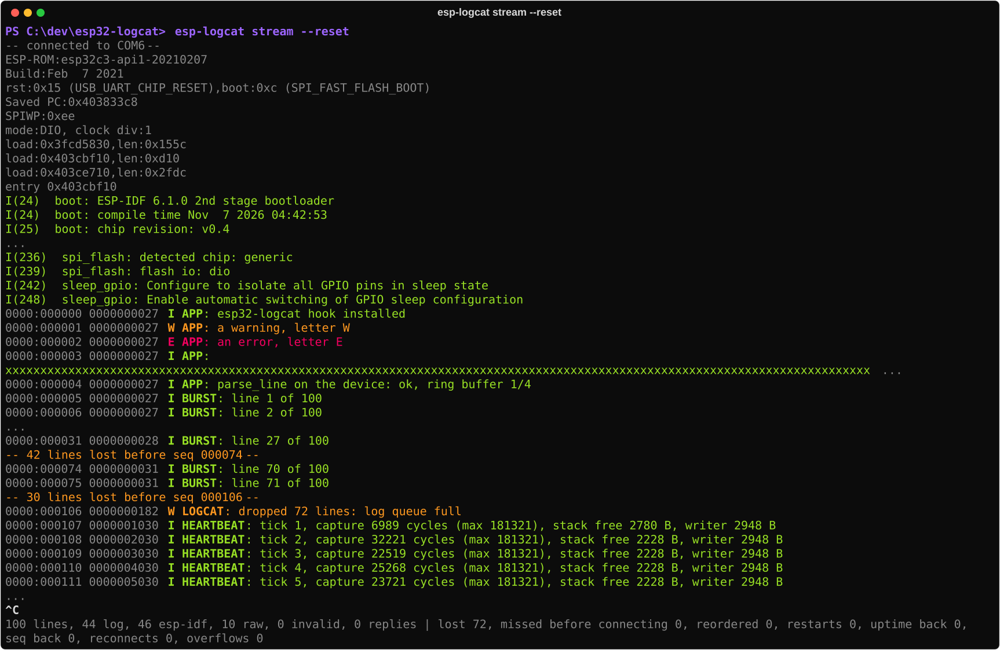

O que aparece, de cima para baixo:

1. `-- connected to COM6 --` — aviso da ferramenta (vai para o stderr, seção 2.3).
2. **Mensagens da ROM** (`ESP-ROM:`, `rst:0x15 ...`) — texto cru, apagado.
3. **Boot do ESP-IDF** (`I (24) boot: ...`) — o formato nativo do IDF, na cor do nível: são os
   logs de antes de o firmware instalar o hook do logcat.
4. **As linhas do logcat** (`0000:000000 0000000027 I APP: ...`) — daqui em diante, todo
   `ESP_LOGx` da aplicação e do próprio IDF passa pelo núcleo do esp32-logcat.
5. A **rajada** do app de demo (`BURST`) e o **heartbeat** a cada segundo.
6. `Ctrl+C` encerra e imprime um **resumo** da sessão.

Pronto: isso é o logcat funcionando.

---

## 2. Lendo a saída

### 2.1 Anatomia de uma linha

```
0000:000107 0000001030 I HEARTBEAT: tick 1, capture 6989 cycles (max 181321), stack free 2780 B
│    │      │          │ │          └─ mensagem (até 127 caracteres; cortada termina em "...")
│    │      │          │ └─ tag (quem logou; até 15 caracteres)
│    │      │          └─ nível: E erro · W aviso · I info · D debug · V verbose
│    │      └─ uptime: milissegundos desde o boot (10 dígitos)
│    └─ seq: número da linha neste boot (6 dígitos, volta a 0 depois de 999999)
└─ boot: contador de boots, guardado na placa (1 a 9999, e volta a 1; 0000 = desconhecido)
```

O `seq` é a peça mais importante: **toda linha que o firmware aceitou ganha um número**, na
ordem. Se faltar um número, uma linha se perdeu, e a ferramenta avisa (seção 3.2). Linhas
silenciadas pelo filtro de tag **não** ganham número: não viram falsas perdas.

Cada linha tem no máximo 170 bytes e só caracteres ASCII imprimíveis (formato completo:
`docs/context/spec/wire-format.md` §1).

### 2.2 Cores

| Nível | Cor | Exemplo |
|-------|-----|---------|
| `E` erro | vermelho | `E APP: an error, letter E` |
| `W` aviso | amarelo | `W APP: a warning, letter W` |
| `I` info | verde | `I HEARTBEAT: tick 1 ...` |
| `D` debug | azul claro | — |
| `V` verbose | cor normal do terminal | — |

- Nas linhas do logcat, o cabeçalho (`boot:seq uptime`) fica apagado; nível e tag em negrito.
- Linhas do ESP-IDF (`I (24) boot: ...`) usam a cor do nível, sem negrito.
- Texto cru (ROM, `printf`) fica apagado.
- Linhas inválidas aparecem com um rótulo vermelho: `!! torn: ...` (seção 3.6).
- Caracteres de controle vindos da placa aparecem escapados (`\x1b`, `\u202E`): a placa
  nunca consegue mexer no seu terminal.

Fora de um terminal (em pipe ou arquivo) as cores somem sozinhas.

### 2.3 Avisos e resumo (stderr)

Tudo que **não** é linha da placa vai para o **stderr**, entre `-- --`:

| Aviso | Significado |
|-------|-------------|
| `connected to COM6` | porta aberta (com `(was COM5)` se a placa voltou em outro número) |
| `waiting for COM6: not available` | porta não existe (placa desligada, cabo fora): tentando de novo a cada 0,5 s |
| `waiting for COM6: port busy` | outro programa está com a porta aberta |
| `COM6: connection lost (...)` | a porta caiu no meio da leitura; a ferramenta espera e reconecta |
| `N lines lost before seq X` | faltaram N números de `seq`: linhas perdidas |
| `N lines written before the connection not received` | linhas escritas antes de você conectar (não é perda da placa) |
| `seq X arrived after Y` | linha fora de ordem (normal em rajadas com várias tarefas) |
| `device restarted (...)` | a placa reiniciou (o `seq` e o uptime voltaram a zero) |
| `uptime went back ...` / `seq went back ...` | linha provavelmente corrompida |

Ao sair (`Ctrl+C`), o resumo conta as linhas de cada tipo e os eventos da sessão:

```
100 lines, 44 log, 46 esp-idf, 10 raw, 0 invalid | lost 72, missed before connecting 0, reordered 0,
restarts 0, uptime back 0, seq back 0, reconnects 0, overflows 0
```

### 2.4 Linhas que o próprio firmware escreve (`LOGCAT`)

O firmware explica as próprias perdas com linhas `W LOGCAT:`, que têm `seq` como qualquer
outra:

| Linha | Quando |
|-------|--------|
| `W LOGCAT: dropped N lines: log queue full` | o código logou mais rápido do que a tarefa escritora conseguia escrever: a fila (32 linhas) encheu e N linhas foram descartadas **sem travar quem logou** |
| `W LOGCAT: N lines not sent to usb: no reader` | a porta nativa ficou fechada (ninguém lendo) e N linhas não foram enviadas por ela |

---

## 3. O que acontece em cada situação

### 3.1 Boot com `--reset`

Visto na seção 1.5. Sem `--reset`, a ferramenta só começa a mostrar a partir de quando você
conecta (a placa continua rodando).

### 3.2 Rajada: a fila encheu

O app de demo loga 100 linhas seguidas no boot, mais rápido do que a tarefa escritora consegue
escrever (o espelho na UART leva ~15 ms por linha). A fila de 32 linhas enche e o resto é
**descartado e contado** — o código que loga nunca espera:

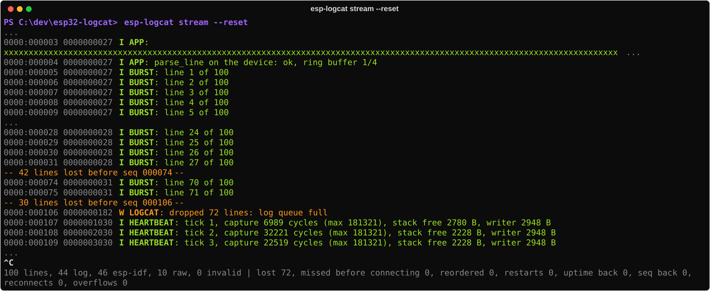

- `-- 42 lines lost before seq 000074 --` e `-- 30 lines lost ... --`: a ferramenta viu os
  buracos no `seq` (27 → 74 e 75 → 106).
- `W LOGCAT: dropped 72 lines: log queue full`: o firmware confirma: 42 + 30 = 72.

É o comportamento desejado: **perder linhas visivelmente é melhor do que atrasar a aplicação**
(ADR-004).

### 3.3 Porta fechada por um tempo e reaberta

A placa continua logando com ninguém lendo a porta nativa; ela **não trava** por isso (cada log
continua levando microssegundos). Ao reabrir:

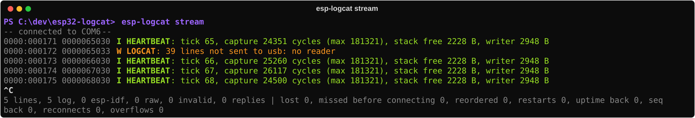

`W LOGCAT: 39 lines not sent to usb: no reader` diz quantas linhas a porta nativa não pôde
enviar enquanto estava fechada. Não há aviso de perda na ferramenta: a primeira linha já é a
atual, e o `seq` segue contínuo a partir dela.

### 3.4 Porta ocupada

Se outro programa (um `pio device monitor`, o monitor do VS Code, outra instância do
esp-logcat) estiver com a porta aberta, a ferramenta espera, e conecta assim que a porta
ficar livre:

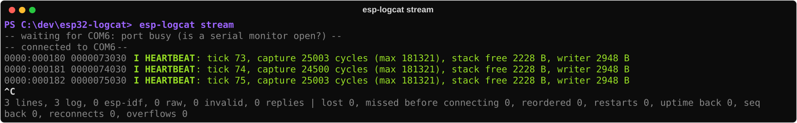

### 3.5 Cabo desconectado, placa reiniciada, COM que mudou

A ferramenta **nunca desiste**: se a porta cai, ela avisa, espera e reconecta.

```
-- COM6: connection lost (ClearCommError failed ...) --
-- waiting for COM6: not available --
-- connected to COM7 (was COM6) --
```

Se a placa voltar com **outro número de COM**, ela é reencontrada pelo número de série (na
porta nativa, o número de série é o MAC da placa) ou, na ponte CH340K, pela posição física no
USB. Se a placa reiniciar, aparece `-- device restarted (...) --`.

### 3.6 Linha rasgada (`!! torn`)

Uma linha sem o `\n` final — típico de uma linha cortada no meio por um reset ou por fechar a
porta — aparece como `!! torn: <bytes>`. Ela é mostrada, nunca confundida com uma linha
válida, e contada no resumo (`invalid (torn N)`).

### 3.7 Hora do PC ao lado (`--time`)

```powershell
esp-logcat stream --time
```

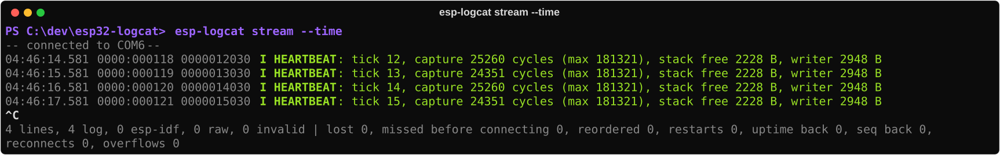

A primeira coluna é a hora do PC em que a linha chegou (`HH:MM:SS.mmm`), útil para cruzar com
outros registros. O uptime da placa continua na linha.

### 3.8 Filtros: só o que interessa

Os filtros seguem a sintaxe do `adb logcat`: cada argumento é `TAG:NÍVEL`, e uma linha aparece
se o nível dela for **igual ou mais grave** que o da sua tag.

```powershell
esp-logcat stream "*:W"                         # só avisos e erros, de todas as tags
esp-logcat stream "*:S" "PRESSURE:D"            # só a tag PRESSURE, até debug
esp-logcat stream "*:W" "HEARTBEAT:I"           # avisos e erros, mais o heartbeat
esp-logcat stream --reset "*:S" "HEARTBEAT:I" "LOGCAT:W"
```

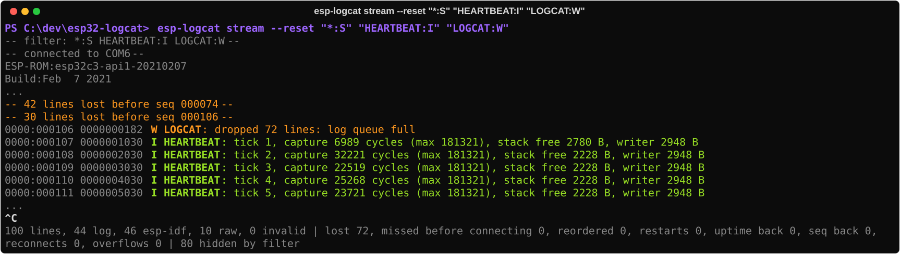

| Parte | Significado |
|-------|-------------|
| `TAG:L` | a tag `TAG` no nível `L` ou mais grave. Níveis, do mais grave ao menos: `E` `W` `I` `D` `V` |
| `TAG:S` ou `TAG:N` | silencia a tag (`S` é o "silent" do adb, `N` o `None` do firmware) |
| `TAG` | o mesmo que `TAG:V` (tudo da tag) |
| `*:L` | o nível de **todas as outras tags**. Sem `*:`, as outras continuam aparecendo |

- A regra da tag vence a do `*`, em qualquer ordem. A mesma tag duas vezes: vale a última.
- A tag diferencia maiúsculas de minúsculas (`HEARTBEAT` ≠ `heartbeat`); o nível, não.
- Linhas sem tag (texto da ROM, `!! torn`) **sempre aparecem**.
- **O filtro só esconde:** as lacunas de `seq` e o resumo continuam contando todas as linhas,
  e o resumo diz quantas foram escondidas (`N hidden by filter`). Esconder uma tag nunca vira
  "linhas perdidas". O stderr começa com `-- filter: ... --` para lembrar o que está ativo.
- Os avisos de `seq` (`lines lost`, `arrived after`) valem para **todas** as linhas, inclusive as
  escondidas: podem citar um `seq` que você não está vendo. Ao silenciar tudo com `*:S`, mantenha
  `"LOGCAT:W"`, senão você não vê as linhas em que a própria placa explica as perdas.
- Vários filtros podem vir num argumento só (`"*:S HEARTBEAT:I"`), e filtros e opções podem
  vir em qualquer ordem (`stream "*:S" --time "APP:D"`).
- Filtro inválido (`APP:F`, `APP:X`) encerra com uma mensagem de erro explicando o que vale.

**Aspas:** no PowerShell e no cmd, `"*:W"` funciona com ou sem aspas. No bash (Git Bash, Linux),
use aspas, senão o `*` vira nome de arquivo.

### 3.9 Reproduzir um log salvo (`replay`)

O `replay` lê um arquivo salvo e o passa **pelo mesmo caminho do `stream`**: mesmo parser,
mesmas cores, mesmos filtros, os avisos de lacuna e de reinício e o resumo. Serve para
analisar uma sessão depois, sem a placa.

```powershell
esp-logcat replay sessao.log                          # tudo, colorido
esp-logcat replay sessao.log "*:W"                    # só avisos e erros
esp-logcat replay sessao.log "*:S" "HEARTBEAT:I" > so-heartbeat.log
```

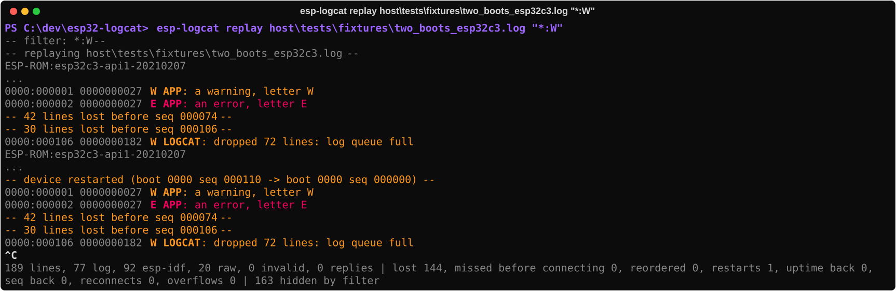

A imagem é o `replay` de uma captura real com **dois boots** (a fixture
`host/tests/fixtures/two_boots_esp32c3.log`): o aviso `device restarted` separa os dois, e o
resumo conta as perdas das duas rajadas (`lost 144`) e o reinício (`restarts 1`).

- O arquivo pode vir do `esp-logcat stream > arquivo` (no PowerShell 5.1 ele sai em UTF-16, e o
  `replay` lê assim mesmo), de um `cmd /c "... > arquivo"`, de uma captura da serial ou,
  quando existir, do `dump` da flash (M5).
- `-` no lugar do arquivo lê do stdin: `type sessao.log | esp-logcat replay - "*:W"`.
- O arquivo é lido de uma vez, sem o ritmo original. Um arquivo salvo com `stream --time`
  também é lido: a coluna de hora é descartada (mostrá-la de volta chega com a #21).
- `--lenient` aceita linhas editadas à mão: a mensagem vazia que perdeu o espaço (`TAG:`
  no fim da linha) e a última linha sem quebra de linha. Sem ele, o `replay` é estrito como
  a placa.
- Um erro de leitura no meio do arquivo (pendrive removido, rede caiu) aparece como
  `-- arquivo: read error (...) --` e o comando sai com código 1: nunca um replay
  incompleto que parece completo.

**O que pode diferir do que você viu ao vivo** (num log comum; uma sessão salva com `--save`, seção 3.10, volta idêntica):

- Um arquivo salvo **com filtro** não tem as linhas escondidas: o `replay` mostra lacunas
  de `seq` onde elas estavam (`N lines lost`). Para analisar depois, salve sem filtro e
  filtre no `replay`.
- Linhas inválidas gravadas como `!! torn: ...` voltam como texto cru, não como inválidas.
- O arquivo não sabe quando a porta foi reaberta: um salto de `seq` que ao vivo era
  "not received before the connection" aparece como `lines lost`.

### 3.10 Salvar a sessão (`--save`)

`--save ARQUIVO` grava **a sessão inteira**: todas as linhas que a placa mandou (mesmo as que o
filtro esconde da tela), com a **data e a hora do PC** ao lado de cada uma, e os avisos de
conexão. O `replay` desse arquivo mostra **exatamente** o que você viu ao vivo: as mesmas
linhas, os mesmos avisos e o mesmo resumo.

```powershell
esp-logcat stream --save sessao.log "*:W"      # a tela só mostra W/E; o arquivo guarda tudo
esp-logcat replay sessao.log --time            # a hora do PC gravada volta na tela
esp-logcat replay sessao.log "*:S" "APP:D"     # filtre depois, do jeito que quiser
```

O arquivo é texto, abre no editor e aceita `findstr`/`Select-String`:

```
# esp-logcat session v1
# 2026-11-08T22:38:38.743 notice connected connected to COM6
2026-11-08T22:38:38.945 ESP-ROM:esp32c3-api1-20210207
2026-11-08T22:38:39.011 0000:000001 0000000027 W APP: a warning, letter W
```

- Cada linha da placa: data e hora do PC (com milissegundos) + os bytes exatos que chegaram.
- Linhas com `#` são do próprio arquivo: o cabeçalho, os avisos de conexão (`notice`) e os
  linhas que um registro comum não guardaria intactas (`raw`, em hex): sem quebra de linha,
  como a cortada por uma queda, ou com `\r`. Num log comum (sem o cabeçalho), `#` é texto da placa.
- Ele é gravado linha a linha: um `Ctrl+C` ou uma queda do PC não perdem o que já chegou.
- `--save` sobrescreve o arquivo. Também funciona no `replay` (para converter um log comum).

---

### 3.11 Interface interativa (`tui`)

Para acompanhar a placa com mais controle que o `stream`: rolar o histórico, pausar, trocar o
filtro sem reiniciar e ver os contadores o tempo todo.

```powershell
esp-logcat tui                                  # porta nativa, se houver só uma
esp-logcat tui --reset "*:W" "HEARTBEAT:I"      # mesmos filtros do stream
esp-logcat tui --replay sessao.log              # sem placa: um log salvo
esp-logcat tui --save sessao.log                # grava a sessão (seção 3.10) enquanto mostra
```

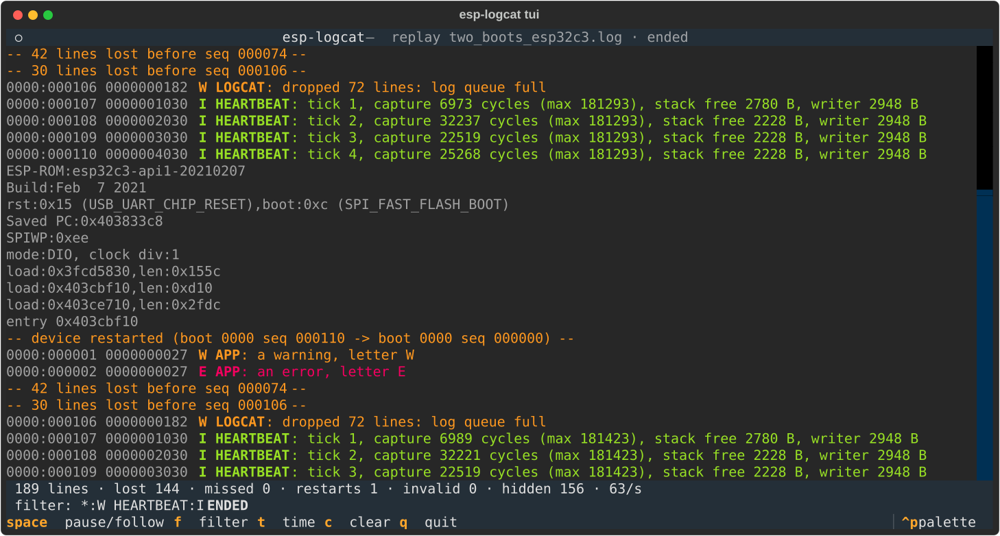

| Tecla | O que faz |
|-------|-----------|
| `espaço` | pausa a tela / volta a seguir. Pausado, as linhas continuam chegando (contadores e histórico); ao voltar, aparece tudo |
| `f` | edita o filtro (`*:W HEARTBEAT:I`); `Enter` aplica e **redesenha o histórico**, `Esc` cancela. Filtro inválido: aviso, e o anterior continua |
| `t` | liga ou desliga a hora do PC em cada linha |
| `c` | limpa a tela (os contadores continuam) |
| `q` ou `Ctrl+C` | sai; o resumo da sessão aparece no terminal |

- O cabeçalho mostra a porta e o estado (`connected`, `waiting`, `disconnected`).
- A linha de status mostra linhas, perdidas, `missed`, reinícios, inválidas, escondidas pelo
  filtro e a taxa (linhas/s).
- Rola com o mouse ou com `PgUp`/`PgDn`; o histórico guarda as últimas 10 mil linhas.
- Funciona no Windows Terminal e no terminal do VS Code. O `stream` continua sendo o melhor
  para pipe e arquivo; o `tui` é para olhar.

---

## 4. Pipe, grep e arquivo

O stdout recebe **só as linhas da placa, exatamente como ela as escreveu** — sem cores, sem
avisos. Os avisos e o resumo vão para o stderr. Isso permite:

**PowerShell**

```powershell
# filtrar ao vivo
esp-logcat stream | Select-String "HEARTBEAT"
esp-logcat stream | Select-String -CaseSensitive " W ", " E "    # só avisos e erros

# só as primeiras 20 linhas (a ferramenta encerra sozinha)
esp-logcat stream | Select-Object -First 20

# salvar a sessão com os bytes exatos da placa (e os avisos em outro arquivo)
cmd /c "esp-logcat stream > sessao.log 2> avisos.log"
```

> **Cuidado no Windows PowerShell 5.1:** `esp-logcat stream > sessao.log` grava o arquivo em
> **UTF-16**, não com os bytes da placa. Use o `cmd /c` acima (ou o PowerShell 7, cujo `>`
> grava UTF-8). Num pipe, o PowerShell mostra "exit code 255" quando encerra o processo no fim
> do pipeline (`Select-Object -First`): é o PowerShell parando o `stream`, não um erro dele.

**Prompt de Comando (cmd)**

```bat
:: salvar a sessão (bytes exatos da placa) e os avisos em outro arquivo
esp-logcat stream > sessao.log 2> avisos.log

:: depois, filtrar o arquivo salvo
findstr HEARTBEAT sessao.log
findstr /C:" W " /C:" E " sessao.log
```

> No cmd, o `findstr` **não serve para filtrar ao vivo**: num pipe (`stream | findstr ...`) ele
> guarda a saída em buffer e não mostra nada até o fim (testado). Para filtrar ao vivo, use o
> PowerShell (`Select-String`) ou os filtros da própria ferramenta (seção 3.8), que funcionam
> igual nos dois terminais. O `>` do cmd grava os bytes exatos.

Os filtros da ferramenta combinam com tudo isto: `esp-logcat stream "*:W" > avisos-e-erros.log`.

---

## 5. As duas portas da placa

| | **Nativa (COM6)** — o logcat | **Ponte UART (COM10)** — o console |
|---|---|---|
| ROM, bootloader, início do boot (formato do IDF) | sim | sim |
| Linhas do logcat | sim, com `\n` | sim (espelho), com `\r\n` |
| `printf` e texto que não é log | não | sim |
| Avisos `W LOGCAT` | sim | sim |
| Abrir a porta reseta a placa? | não | não, se aberta com DTR/RTS soltos (o esp-logcat e o `pio device monitor` deste projeto fazem isso) |

Use a **nativa** para o logcat. Use a **COM10** quando precisar do console completo
(`esp-logcat stream --port COM10` também funciona) ou quando estiver gravando pela nativa.

---

## 6. Solução de problemas

| Sintoma | Causa provável | O que fazer |
|---------|----------------|-------------|
| `cannot choose a port (found: ...); use --port` | nenhuma porta nativa, ou mais de uma | rode `esp-logcat ports` e passe `--port COMx` |
| `waiting for COM6: port busy` | outro programa com a porta aberta | feche o monitor serial (VS Code, PlatformIO, outro terminal) |
| `waiting for COM6: not available` sem fim | placa desligada, cabo só de energia, ou a porta mudou de número e a placa ainda não tinha sido vista nesta sessão | confira o cabo; rode `esp-logcat ports` |
| `esp-logcat` não é reconhecido como comando | o ambiente não está ativado neste terminal | ative (seção 1.2) ou use `host\.venv\Scripts\esp-logcat.exe` |
| A porta nativa sumiu depois de um reset pela CH340K; o Windows mostra "Dispositivo USB Desconhecido" | placa atrás de um hub (`hardware.md`, item 5) | desconecte e reconecte o cabo; ligue a nativa direto no PC |
| Muitos `lines lost` com tráfego alto | a aplicação loga mais de ~70 linhas/s (limite do espelho na UART) | esperado: as perdas são contadas, nunca travam a aplicação. O app de 1 kHz (#13) vai desligar o espelho |
| `W LOGCAT: N lines not sent to usb` | a porta nativa ficou fechada | normal: são as linhas do período em que ninguém lia |
| Nada aparece na COM6, mas a COM10 mostra os logs | firmware antigo, de antes do logcat | grave o firmware atual (seção 1.3) |
| Gravar falha com a porta aberta | o `stream` está segurando a COM | pare o `stream` (`Ctrl+C`) antes de gravar, ou grave pela outra porta |

---

## 7. Referência rápida

```
esp-logcat ports                         lista as portas e marca a nativa
esp-logcat stream [opções] [TAG:L ...]   logs ao vivo, com filtros opcionais (seção 3.8)
    "*:W"  "*:S" "TAG:D"  ...            filtros do logcat: níveis E W I D V, S/N silencia
    --port COMx                          porta (padrão: a nativa, se houver só uma)
    --baud N                             baud rate (padrão 115200; só importa na COM10)
    --reset                              reinicia a placa ao conectar
    --time                               mostra a hora do PC em cada linha
    --save ARQUIVO                       grava a sessão inteira (seção 3.10)
esp-logcat replay ARQUIVO [TAG:L ...]   reproduz um log salvo, com filtros (seção 3.9)
    -                                    no lugar do arquivo: lê do stdin
    --lenient                            aceita linhas editadas à mão
    --time                               mostra a hora gravada numa sessão
    --save ARQUIVO                       grava de novo como sessão
esp-logcat tui [opções] [TAG:L ...]     interface interativa (seção 3.11):
    --port, --reset, --save, --replay ARQUIVO, --lenient
esp-logcat shell [COMANDO | TAG:L ...]  comandos da placa (seção 8): um só, ou o prompt
    --json                               um comando: resposta em JSON
    --port, --baud
esp-logcat --version
```

Ainda não implementado: `dump` (marco M5). Os comandos que a placa entende estão na
[seção 8](#8-comandos-do-console).

---

## 8. Comandos do console

A placa aceita comandos pela **porta nativa** (a mesma do `stream`), e o `esp-logcat shell` é
quem fala com ela. O contrato exato está em `docs/context/spec/wire-format.md` §2 e §3.

### 8.1 Como mandar um comando

**Um comando só**: a resposta aparece e o programa termina. O código de saída é 0 quando deu
certo e 1 quando não deu, bom para scripts:

```powershell
esp-logcat shell info
esp-logcat shell log level APP D
esp-logcat shell stats --json
```

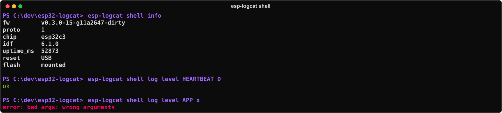

**Interativo**: sem comando, abre um prompt. As linhas de log continuam aparecendo acima do que
você digita, com os mesmos filtros do `stream` (seção 3.8):

```
esp-logcat shell "*:W"
logcat> stats
logcat> log level HEARTBEAT D
logcat> quit
```

Aqui só o `HEARTBEAT` aparece; as linhas `D` dele surgem depois do `log level HEARTBEAT D` e
somem depois do `I`:

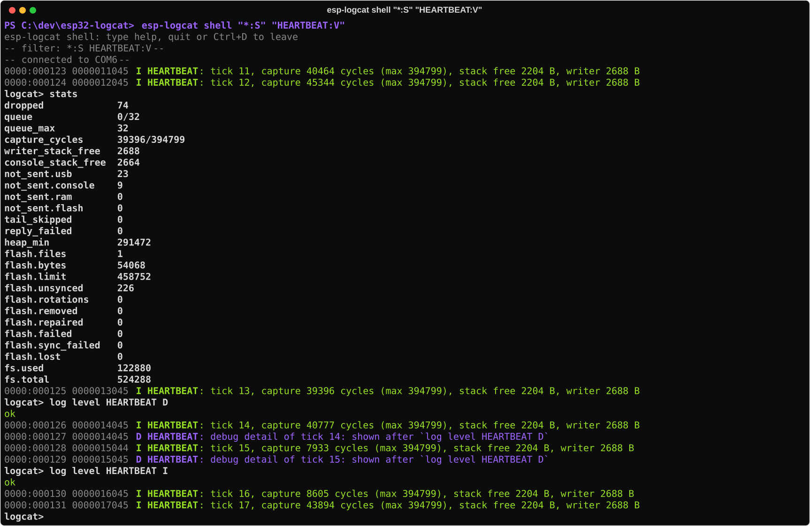

No prompt, `help` lista os comandos, as setas trazem os anteriores, e Ctrl+D (ou `quit`) sai.

**Vários comandos de um script**: um por linha, pela entrada padrão.

```powershell
"info`nlog level APP D`nstats" | esp-logcat shell "*:E"
```

O shell numera os pedidos sozinho: você digita `info`, e ele manda `5312 info` e espera a resposta
com aquele número. Ele espera 2 s pela resposta; `reboot` e `crash` esperam até 10 s pelo
reinício. O Windows só deixa um programa por vez na porta: feche o `stream` ou o `tui` antes.

### 8.2 O que passa no fio

O shell mostra a resposta de forma legível. Por baixo, a placa manda:

| Linha | O que é |
|-------|---------|
| `#> <id> chave=valor ...` | dados; pode haver mais de uma |
| `#. <id> ok` | fim, deu certo |
| `#! <id> <código> <texto>` | fim, deu errado |
| `#BEGIN <id> ram <bytes>` … `#END <id> <crc32>` | um bloco com linhas de log inteiras |

Toda resposta termina em exatamente um `#.` ou `#!` (menos `crash`, que não responde). O
`--json` monta um objeto a partir desses campos; números viram números.

### 8.3 Cada comando, com a saída real

As saídas abaixo foram capturadas na placa com o próprio `esp-logcat shell`.

**`info`**: quem é a placa.

```
> esp-logcat shell info
fw         v0.3.0-23-g92b757f
proto      1
chip       esp32c3
idf        6.1.0
uptime_ms  26670
boot       5
reset      USB
flash      mounted
```

| Campo | Significado |
|-------|-------------|
| `fw` | versão do firmware (`git describe` na hora do build) |
| `proto` | versão do protocolo do console |
| `chip` | o chip |
| `idf` | versão do ESP-IDF |
| `uptime_ms` | tempo desde o boot, em ms |
| `reset` | por que reiniciou: `POWERON` (ligou), `USB` (reset pela USB), `EXT` (pino EN), `SW` (`reboot`), `PANIC` (crash), `INT_WDT`, `TASK_WDT` ou `WDT` (watchdogs), `BROWNOUT` (tensão baixa), `DEEPSLEEP`, `SDIO`, `JTAG` |
| `flash` | o log na flash: `mounted`, `formatted` ou `failed` (seção 9) |

Campo que a placa não sabe medir não aparece: nunca vem como `0`. O `boot` é o mesmo número
do começo das linhas; ele some se a placa não conseguiu ler o contador.

**`stats`**: os contadores do motor de log. Só lê: não zera nada.

```
> esp-logcat shell stats
dropped             74
queue               0/32
queue_max           32
capture_cycles      22264/43685
writer_stack_free   2688
console_stack_free  2664
not_sent.usb        23
not_sent.console    2
not_sent.ram        0
not_sent.flash      0
tail_skipped        0
reply_failed        0
heap_min            291472
flash.files         1
flash.bytes         28392
flash.limit         458752
flash.unsynced      447
flash.rotations     0
flash.removed       0
flash.repaired      0
flash.failed        0
flash.sync_failed   0
flash.lost          0
fs.used             65536
fs.total            524288
```

Em JSON (`esp-logcat shell stats --json`):

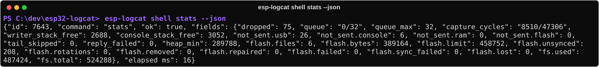


| Campo | Significado |
|-------|-------------|
| `dropped` | linhas recusadas porque a fila estava cheia, desde o boot |
| `queue` | linhas na fila agora / capacidade |
| `queue_max` | o máximo que a fila já teve desde o boot |
| `capture_cycles` | custo de logar para quem loga, em ciclos de CPU: último / máximo |
| `writer_stack_free`, `console_stack_free` | menor folga de stack já vista em cada tarefa, em bytes |
| `not_sent.<saída>` | linhas que aquela saída recusou desde o boot (`usb`, `console` = espelho UART, `ram`, `flash`) |
| `tail_skipped` | linhas que não entraram no `log tail` porque um bloco estava sendo enviado |
| `reply_failed` | respostas ou linhas de resposta que não conseguiram sair |
| `heap_min` | o menor heap livre já visto desde o boot, em bytes |
| `flash.*`, `fs.*` | o log guardado na flash: veja a seção 9.4 |

Os contadores só sobem; para ter uma taxa, leia duas vezes e subtraia.

**`log level <tag> <nível>`**: muda o nível de uma tag com a placa rodando. Níveis: `E`, `W`, `I`,
`D`, `V`, ou `N` para silenciar. A tag `*` muda o nível padrão.

```
> esp-logcat shell log level HEARTBEAT D
ok
```

Depois disso as linhas `D` dessa tag aparecem no `stream`:

```
0000:000120 0000011030 D HEARTBEAT: debug detail of tick 11: shown after `log level HEARTBEAT D`
```

A placa guarda até 16 tags. A 17ª dá erro, e as que já estão na tabela continuam mudando:

```
> esp-logcat shell log level TAG14 W
error: full: tag table full (16 tags)
```

O nível não sobrevive a um reinício. A tag é comparada com o nome usado no código, não com o
que a linha mostra: no log, espaço e `:` da tag aparecem como `_`.

**`log tail`**: as últimas 32 linhas guardadas em RAM, num bloco.

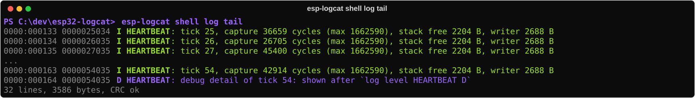


O shell lê o bloco pelo tamanho anunciado no `#BEGIN` e confere o CRC-32 antes de mostrar as
linhas. Enquanto o bloco sai, o log ao vivo não vai para a USB. Depois de um bloco sob carga, pode aparecer
`W LOGCAT: N lines not sent to usb: no reader`: são as linhas desse intervalo.

**`log sync`**: grava na flash, de forma durável, tudo o que foi logado até agora. Só responde
`ok` depois do sync. Responde erro se não conseguiu: `failed` (o sync falhou, ou a placa logou
sem parar e a fila não esvaziou em 1,2 s) ou `unsupported` (sem flash nesta execução).

```
> esp-logcat shell log sync
ok
```

**`log dump`**: os logs guardados na flash, um bloco por arquivo, do mais antigo ao mais novo.
Antes, a placa sincroniza a flash, e cada arquivo vem com o tamanho que tinha nesse momento: o
que for logado durante o dump fica para o próximo. O shell confere o CRC de cada bloco e fecha
cada um com uma linha de resumo:

```
> esp-logcat shell log dump
0082:000119 0000008808 W LOGCAT: log cleared by console: 1 files, 3239 bytes removed
...
log_030.txt: 1388 lines, 65439 bytes, CRC ok
...
log_036.txt: 49 lines, 5636 bytes, CRC ok
```

Com a flash cheia (448 KB em 7 arquivos), o dump leva cerca de 1 s pela USB nativa. Enquanto
ele sai, o log ao vivo não vai para a USB (como no `log tail`), e um pedido feito nesse meio-tempo
só é respondido no fim. Se a rotação apagar um arquivo durante o dump (log muito intenso), a
resposta é `failed log rotated during dump`, e os blocos que já chegaram inteiros valem.
Gravar os arquivos no PC é com o `esp-logcat dump`, que vem no host em Rust (#101).

**`log clear`**: apaga todos os arquivos de log da flash e recomeça num `log_000.txt` vazio.
**Não tem volta.** A primeira linha do log novo registra quantos arquivos e bytes saíram, e o
boot e o uptime dela dizem quando:

```
> esp-logcat shell log clear
ok
```

Respostas de erro: `busy` (um `log dump` está saindo; nada foi apagado), `failed` (um arquivo
não saiu, ou a placa logou sem parar e o pedido não foi atendido em 1,2 s: nesse caso nada foi
apagado) ou `unsupported` (sem flash nesta execução).

**`reboot`**: responde e reinicia; o shell espera ver o reinício. O `info` seguinte mostra
`reset SW`.

```
> esp-logcat shell reboot
ok: the device restarted
```

**`crash panic`** e **`crash wdt`**: derrubam a placa de propósito, para testar a recuperação. Não
respondem: o shell considera o reinício o sucesso. Depois, o `info` mostra `reset PANIC` ou
`reset INT_WDT`:

```
> esp-logcat shell crash panic
ok: the device restarted
> esp-logcat shell info
fw         v0.3.0-23-g92b757f
proto      1
chip       esp32c3
idf        6.1.0
uptime_ms  175
boot       6
reset      PANIC
flash      mounted
```

### 8.4 Erros

Todo erro sai no stderr, e o código de saída é 1.

| O que aparece | Quando |
|---------------|--------|
| `error: bad_args: wrong arguments` | argumento faltando, sobrando ou inválido (`log level APP x`) |
| `error: full: tag table full (16 tags)` | a tabela de tags está cheia |
| `error: unsupported: no flash storage` | a flash não montou nesta execução (`log sync`, `log dump`, `log clear`) |
| `error: busy: a log dump is being sent: try again after it` | `log clear` durante um `log dump` |
| `error: failed: ...` | o `log sync`, o `log dump` ou o `log clear` não conseguiu (o texto diz o quê) |
| `error: timeout: host not reading` | a placa não conseguiu mandar a resposta a tempo |
| `error: no reply in 2 s` | nenhuma resposta: placa travada, ou firmware sem console |
| `error: no reply: the device restarted` | a placa reiniciou no meio do pedido (ou `the port closed`) |
| `error: no restart seen in 10 s` | `reboot` ou `crash` sem reinício |
| `error: dump block damaged: ...` | um bloco do `log tail` ou do `log dump` chegou incompleto ou com CRC errado |
| `unknown command: ...` | a palavra não é um comando da placa; o shell nem manda |

Os códigos `bad_args`, `full`, `busy`, `failed`, `unsupported` e `timeout` vêm da placa; os outros, do shell. Uma
placa que recebe um comando que não conhece responde `bad_command`, mas o shell já barra isso
antes. Comandos são em minúsculas e sem abreviação; os níveis são em maiúsculas.

---

## 9. O log na flash

A placa guarda tudo o que loga numa partição de 512 KB da própria flash (LittleFS). O log
sobrevive a um `reboot`, a um crash e a um corte de energia; ele só aparece no PC pela USB (como
sempre) e, quando o `dump` chegar (#29), também baixado da flash.

### 9.1 Onde e quanto

- Arquivos `log_000.txt`, `log_001.txt`… de até 64 KB cada, no máximo 448 KB juntos. Quando
  enche, o mais antigo é apagado: fica sempre o log mais recente.
- Cada linha é a mesma que aparece no `stream`. Ao reabrir um arquivo que terminou no meio de
  uma linha (um corte de energia na hora errada), a placa fecha o pedaço com um byte especial,
  e ele aparece como `!! torn` quando for lido, nunca grudado na linha seguinte.

### 9.2 A linha de boot

No começo de cada boot, a placa diz quem é este boot e o que achou na flash:

```
0006:000000 0000000076 I LOGCAT: boot=6 reason=SW fw=v0.3.0-23-g92b757f
0006:000001 0000000084 I LOGCAT: flash: mounted, 6 files, 390780 bytes of 458752, last line whole, littlefs 412/512 KB
```

Na primeira linha:

| Parte | Significado |
|-------|-------------|
| `boot=6` | o contador de boots, guardado na NVS: sobe 1 a cada boot, qualquer que seja o motivo. É o mesmo número do começo de cada linha (`0006:`), que separa o log de um boot do outro na flash |
| `reason=SW` | por que reiniciou: os mesmos nomes do `info` (seção 8.3); `UNKNOWN` se o chip não disse |
| `fw=...` | a versão do firmware que está rodando |

Se a NVS foi apagada (cheia ou de outra versão do ESP-IDF), antes vem
`W LOGCAT: boot counter restarted: NVS was erased`, e a contagem volta a 1. Se a placa não
conseguiu ler o contador, vem `E LOGCAT: boot counter unavailable: lines carry boot 0000`.

Na segunda:

| Parte | Significado |
|-------|-------------|
| `mounted` | achou a partição com o log anterior. `formatted (first use)`: a partição estava em branco e foi formatada. Se ela não montar por outro motivo, antes vem `W LOGCAT: flash: FORMATTED: ... the previous logs are lost`. `mount failed`: o log não é guardado nesta execução |
| `6 files, 390780 bytes of 458752` | quanto log está guardado, e o limite |
| `last line whole` | o último arquivo terminava numa linha inteira. `last line torn: closed` quer dizer que ele terminava no meio de uma linha, e a placa a fechou |
| `littlefs 412/512 KB` | quanto da partição o próprio LittleFS usa (blocos e metadados) |

Para ver essa linha, abra o stream com `--reset`: sem ele, ela já passou quando a porta abre.

### 9.3 O que se perde, e quando

Escrever no arquivo não basta: só o **sync** torna o log durável. A placa sincroniza:

- **a cada 5 s**, se há algo novo (mesmo sob log intenso, porque é conferido a cada linha);
- **depois de uma linha ERROR**, assim que a rajada de linhas termina: na hora numa placa
  calma, em até ~2 s sob carga. Nunca mais de **um sync por segundo**: uma rajada de erros
  não gasta a flash;
- **quando você pede** (`esp-logcat shell log sync`, seção 8.3) e antes de um `reboot`.

Por que o ERROR não sincroniza dentro da própria linha: o sync apaga um setor da flash
(dezenas de ms), e nesse tempo a fila de 32 linhas enche. As linhas descartadas seriam
justamente as que vêm depois do erro e o explicam.

| Situação | O que fica na flash |
|----------|---------------------|
| `esp-logcat shell reboot` | tudo até o reboot |
| `esp-logcat shell log sync` respondeu `ok` | tudo o que foi logado antes do pedido |
| `crash panic`, `crash wdt`, travamento | tudo até o último sync: até 5 s antes, e uma linha ERROR até ~1 s (o `crash` imita um crash de verdade e não grava nada antes) |
| Corte de energia | o mesmo: até 5 s, ERROR até ~1 s |
| Partição cheia | não acontece: o mais antigo é apagado antes |

Em todos os casos, também se perdem as linhas que ainda estavam na fila (até 32).

### 9.4 Acompanhando pelo `stats`

O `esp-logcat shell stats` (seção 8.3) mostra a flash nos campos `flash.*` e `fs.*`:

| Campo | Significado |
|-------|-------------|
| `flash.files`, `flash.bytes`, `flash.limit` | arquivos, bytes guardados e o limite |
| `flash.unsynced` | bytes escritos que ainda não foram para a flash (o que um corte agora perderia) |
| `flash.rotations`, `flash.removed` | arquivos novos começados, e antigos apagados para caber |
| `flash.repaired` | linhas cortadas que a placa fechou ao reabrir um arquivo |
| `flash.failed`, `flash.sync_failed`, `flash.lost` | linhas que não entraram, gravações que falharam, bytes perdidos por isso. Esperado: 0 |
| `fs.used`, `fs.total` | o que o LittleFS usa da partição, e o tamanho dela |
| `flash.sync_period`, `flash.sync_error`, `flash.sync_request` | syncs feitos desde o boot, por motivo: o período de 5 s, uma linha ERROR, um pedido (`log sync`, `reboot`) |
| `erase.sectors` | setores de 4 KB apagados na flash inteira desde o boot (o log e a NVS): é o que gasta a flash. Dividido pelo tempo de boot, dá o ritmo de desgaste |

O `info` ganhou `flash`: `mounted`, `formatted` ou `failed`.

### 9.5 A medição de tempo (build separado)

A medição de quanto o log atrasa uma tarefa de 1 kHz (linhas `TIMING`, da #13) não roda mais no
firmware normal: ela loga 1000 linhas/s, que iriam para a flash (~2 MB por boot) e empurrariam
para fora o log do boot anterior, justamente o que um crash deixou. Ela tem um build próprio:

```powershell
C:\.platformio\penv\Scripts\pio.exe run -d firmware -e esp32c3_timing -t upload --upload-port COM6
```

Nesse build ela roda uma vez por boot. Com a flash ligada, a tarefa de log fica mais lenta que
1000 linhas/s e aparecem linhas `dropped N lines: log queue full`: o excesso é descartado e
contado, nunca trava a aplicação.

---

## Como as imagens foram feitas

1. `scripts/record_session.py <porta> <segundos> <saida.json> [--reset]` grava, de uma sessão
   real com a placa, exatamente o que o transporte serial entregou (bytes e avisos) com o tempo
   de cada um. As gravações estão em `docs/project/manual/sessions/`.
2. `scripts/manual_screenshots.py` passa cada gravação pelo mesmo pipeline e pelo mesmo
   renderer do `esp-logcat stream` e exporta a janela de terminal em SVG para
   `docs/project/manual/img/`. Cortes em sessões longas aparecem como `...`.
   As imagens do `shell` vêm de `scripts/record_shell.py <porta> <saida.json>`, que grava
   execuções reais do shell (os bytes recebidos e os comandos enviados); o script as passa
   pelo mesmo código do shell (casamento de respostas, blocos, `print_reply`).
3. `scripts/readme_cover.py` desenha a capa do README (`docs/project/img/cover.svg`) com saída real
   das mesmas gravações.

Quando a saída mudar, grave de novo e rode os scripts: as imagens sempre mostram o que a
ferramenta realmente faz.
